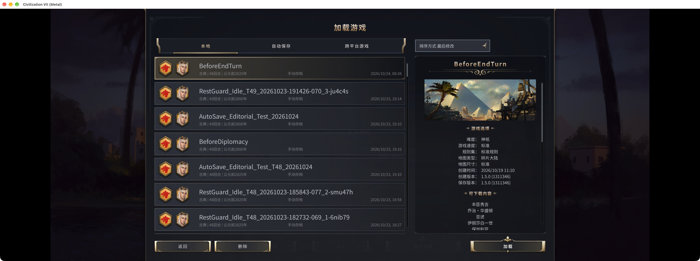
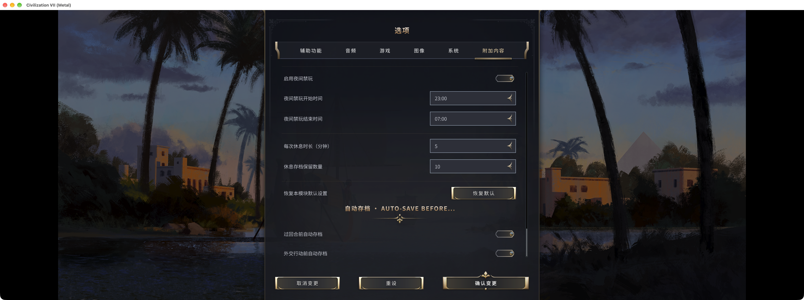

# Auto-save Before… — Civ VII Rescue Project

You've finished moving your units and managing your cities, then press Next Turn and notice something you missed. Loading the usual autosave means doing those actions again. I made Auto-save Before… to keep a checkpoint immediately before ending the turn or confirming a major diplomatic action.

## 1. Keep the work you did this turn

A start-of-turn autosave can be too far back when all you want to undo is the decision to end the turn.

BeforeEndTurn records the state immediately before the next-turn action proceeds, keeping the city management and unit moves you have already completed.

*A checkpoint before ending the turn. Captured on macOS with mod 1.1.1.*

## 2. A checkpoint before diplomatic commitments

An AI leader may reject a diplomatic proposal. When an action involves Influence costs and relationship consequences, you may want to reconsider before committing rather than replay the whole turn.

BeforeDiplomacy keeps a checkpoint before supported diplomatic actions are submitted, so you can reload and reconsider the target or action. It uses a separate slot from BeforeEndTurn; reloading does not guarantee the AI will accept a repeated proposal.

*Separate turn and diplomacy checkpoints. macOS, mod 1.1.1; the diplomacy entry is an existing save.*

*Settings are in the game’s Add-ons options, also accessible from the map save entry.*

## Availability and testing

For single-player. Each fixed checkpoint is shared across campaigns on the same computer and overwritten by the next matching action; keep separate saves for anything you want to retain. These three screenshots show the installed macOS 1.1.1 interface and a turn-end save; Workshop is on 1.1.2. A complete diplomatic save/load round trip was not retested for this article.

[Auto-save Before… on Steam Workshop](https://steamcommunity.com/sharedfiles/filedetails/?id=3815596737)

Feedback is welcome. Please include your platform, game version, related mods and the action you were taking when something went wrong.
