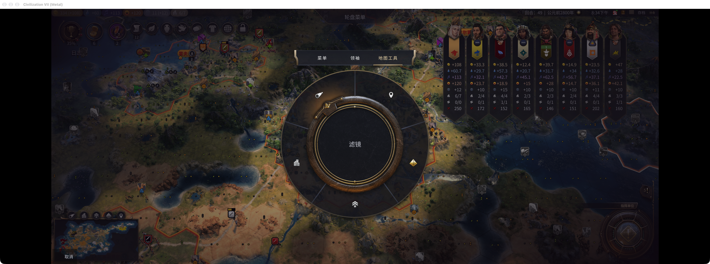
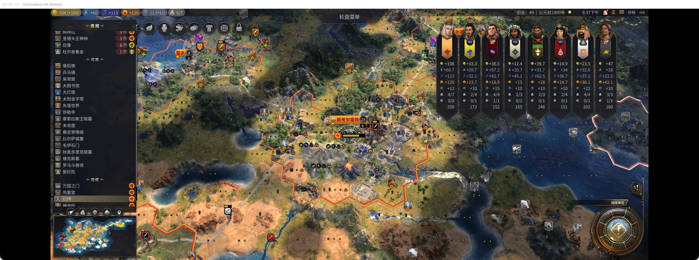
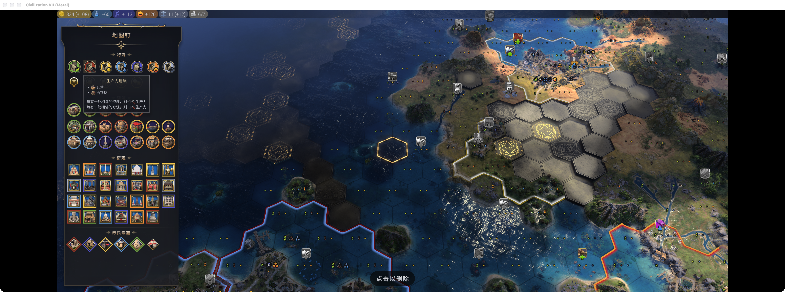
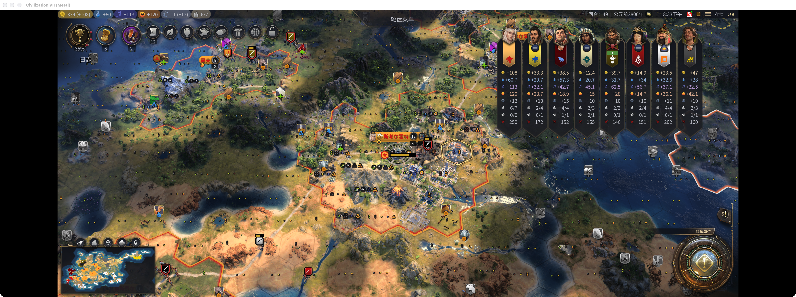
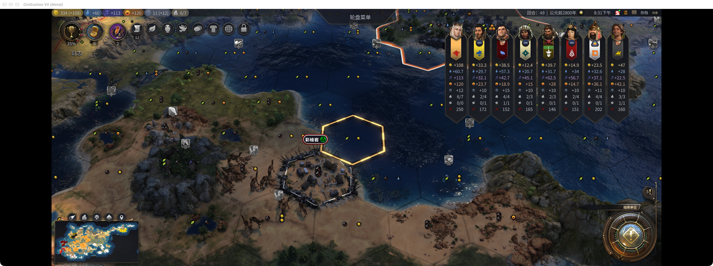
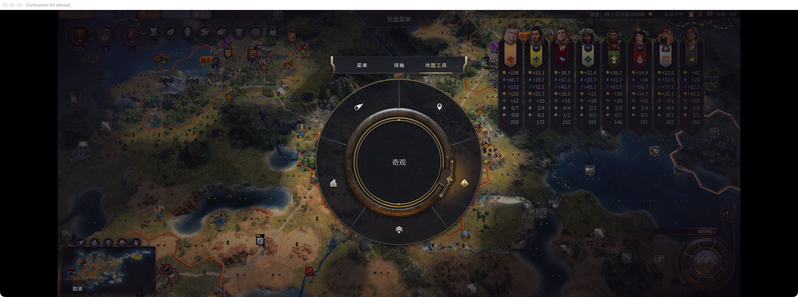

# 《文明7拯救计划》｜更好的手柄支持

《文明7拯救计划》记录我为游戏做的一些小修补。第一期先解决用手柄时那些够不着的按钮、跟不上的光标，以及不顺手的输入。

**更好的手柄支持（Better Controller Support）** 已在 Steam 创意工坊发布。下面介绍已发布的 0.2.1 版本；配图取自 0.2.0。

## 1 地图工具进入手柄轮盘

**痛点**

滤镜、城市、单位、奇观、地图钉都挤在左下角。用手柄玩时，这些按钮不容易访问，想查点信息还得拿起鼠标。

**解决方案**

模组把可用的地图工具放进原生轮盘。0.2.1 中，选好工具后按一次 A 就直接打开对应界面，按 B 关闭后回到地图，省去左下角按钮的中转。图标与左下角按钮保持一致，找工具时不用重新认一套符号。新版入口已通过离线检查，尚待实机验证。

*轮盘里可以直接找到地图工具。*

## 2 长列表跟着选中项滚动

**痛点**

打开城市、单位或奇观列表之后，如果选中项不明显，或者移到屏幕外却不跟着滚动，手柄操作还是会卡在半路。

**解决方案**

模组为支持的列表补上焦点导航，用金色边框标明当前选中项，长列表会自动滚动到它所在的位置，隐藏和不可用的项目会跳过。城市、单位和奇观列表需搭配 Map Trix。

0.2.0 的取图中发现返回工具栏时的焦点问题。0.2.1 已改为关闭工具后直接回地图，相关离线检查通过，实机返回效果仍待确认。

*列表会跟随选中项滚动，当前焦点一眼可见。*

## 3 地图钉图标可以用手柄选择

**痛点**

规划城市时想先放几个地图钉，但图标选择面板缺少顺手的手柄导航，思路容易被切换鼠标打断。

**解决方案**

搭配 Detailed Map Tacks，模组为图标选择器补上方向导航。选好图标后，交回原模组的地图放置流程，让手柄能够走到规划标记的入口。放置、预览和删除仍由 Detailed Map Tacks 提供。

*地图钉的图标选择也有了手柄导航。*

## 4 补齐 Mac 地图输入

**痛点**

在 Mac 上，即使游戏已经识别了手柄，地图摇杆或轮盘入口仍可能没有正确响应，菜单能操作、回到地图却不顺手。

**解决方案**

模组为 Mac 增加地图输入兼容，处理地块选择、镜头移动和轮盘唤出。Mac 默认开启，Windows 默认保留原生地图输入；地图工具功能在两边都可使用。

*Mac 地图输入兼容开启后的地图界面。*

## 5 让地块光标回到镜头中心

**痛点**

镜头已经移到远处，选中的地块却还留在原地。接下来想操作眼前的格子，只能把光标一格一格挪回来。

**解决方案**

开启输入兼容后，按下右摇杆 R3，就能把选中地块移到当前镜头正中央。看向哪里，就可以把选择带到哪里，省去来回追光标。

*R3 将选中地块带到当前镜头中央。*

## 6 左右摇杆方向分别设置

**痛点**

选地块和推镜头是两种不同的操作习惯。把上下方向绑在一起，往往调舒服了一边，另一边又别扭。

**解决方案**

模组提供独立的左右摇杆上下方向选项，分别对应地块光标和镜头移动。这两项用于输入兼容模式；本次已确认设置页显示，修改后的保存与生效仍待补测。

*设置页提供独立的左右摇杆上下方向选项。*

## 7 修复菜单中的摇杆响应

**痛点**

有些情况下，主菜单或轮盘能用方向键切换，左摇杆却没有反应。明明是同一个手柄，进出不同界面时表现却不一致。

**解决方案**

模组补上菜单对左摇杆输入的兼容，让选中项能跟着摇杆移动。轮盘里，图标高亮和中央名称会同步切换，不必为了选一个入口再改用方向键。

*左摇杆切换菜单选中项后的界面。*

[Steam 创意工坊订阅：更好的手柄支持](https://steamcommunity.com/sharedfiles/filedetails/?id=3825193325)

可选搭配：[Map Trix](https://steamcommunity.com/sharedfiles/filedetails/?id=3507072814)、[Detailed Map Tacks](https://steamcommunity.com/sharedfiles/filedetails/?id=3507297712)。

本文七张配图来自 0.2.0 的 Mac 实机，展示各功能界面，不作为 0.2.1 一次确认打开或返回流程的实测证据。地图移动、R3 回中和轮盘切换已获得实体手柄反馈；列表与地图钉导航通过游戏内合成输入核验。Windows、其他型号手柄，以及设置修改后的保存效果仍待补测。
