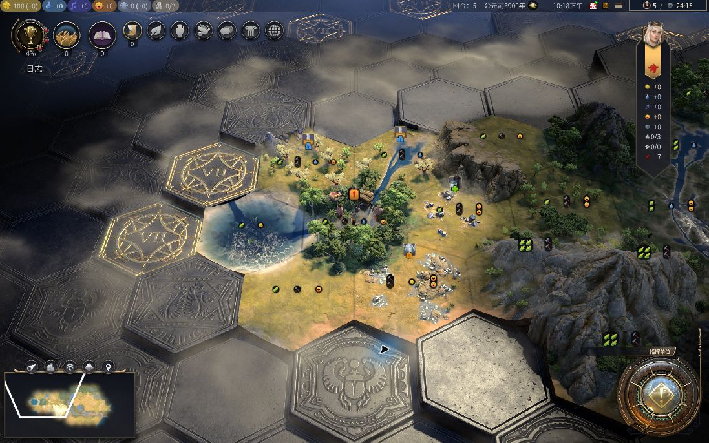

# 《文明7拯救计划》｜不再来一回合

“处理完这件事就下线。”然后还有一个城、一个科技、下一回合的战斗。文明最难结束的往往不是战争，而是今天的游戏时间。「不再来一回合」给单人游戏加上几个明确的停顿点，让休息不再完全依赖临时的自觉。

## 1. 按回合休息，后期少一点“再来一次”

前期五回合很快，后期一回合却可能安排半个帝国。固定“再玩五回合”，到了后期就很容易变成很久。

默认休息间隔随当前回合阶段从五回合逐步缩短到一回合，也能自行调整。达到间隔后，在回合边界停下来休息；完成休息后，回合和时间两种计数一起重新开始。

*历史 1.3 系列实机图：达到回合间隔后的休息倒计时。当前版界面已有变化。*

## 2. 一回合还没结束，也别一直坐着

只按回合提醒，遇到大战、城市规划或反复比较建造选项时，就可能一直等不到休息。

连续游戏时间也单独计时，默认玩 25 分钟、休息 5 分钟。时间和回合规则可以一起使用；完成一次足额休息就同时重置两种累计，避免刚休息完又立刻被另一条规则拦住。

## 3. 已经离开电脑，就把这次休息算上

已经起身喝水，再回来却又被要求从头休息，提醒就会变得不近人情。

默认闲置一分钟会进入主动休息计时。可以随时继续游戏；休息满要求时长后，两种累计都会重置。提前回来则保留之前的游戏累计，不会因为动一下鼠标就伪造完成了一次休息。

## 4. 到点收工，不和下一回合讨价还价

最容易拖延的不是忘了时间，而是知道已经很晚，仍想把眼前这一步做完。

夜间限制默认覆盖 22:00 到次日 07:00，可独立开关和调整时段。限制期间保留退出入口，但不开放继续游戏；若要修改安排，可以回到主菜单设置。

## 5. 休息前留一份独立存档

愿意停下来，却担心刚才的进度没有落盘；或者休息越多，存档列表越长。

主动、时间、回合和夜间休息会创建带时间信息的 RestGuard 存档，并显示保存状态。默认保留最近十份，可调整数量；清理只针对模组自己的旧存档，且在新存档成功后进行，不会拿普通自动存档来凑数。

## 6. 离下次休息还有多久，一眼看清

提醒完全不露面时容易忘记，做成巨大面板又会一直挡住游戏。

地图 HUD 用紧凑的时间和回合提示显示进度，也提供设置入口。间隔、休息时长和夜间时段集中在原生选项中，让提醒按自己的节奏工作。

*历史实机图：右上角的紧凑时间与回合提示。当前数值和布局请以新版为准。*

## 适用范围与进展

本文以已发布的 1.8.5 功能为范围。默认参数可以调整，休息限制作用于游戏内，不是系统级锁定。旧版实机图仅作界面参考；新版夜间、存档保留、设置保存及全部手柄流程仍需逐项补齐实机证据。休息存档须看到成功提示后再放心退出。

[Steam 创意工坊：不再来一回合](https://steamcommunity.com/sharedfiles/filedetails/?id=3815557333)

如果遇到问题，欢迎说明游戏版本、平台、相关 Mod，以及出现问题时正在进行的操作。
