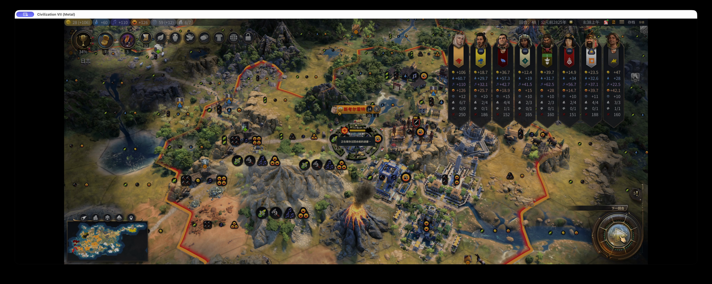

# 已发布图文

仅收录已有成功发布回执的文案。目录名与 `mods/` 对应；发布状态与时间见 [publications.json](publications.json)。

- [reddit 文案](reddit-en.md) · [已发布页面](https://www.reddit.com/r/CivVII/comments/1xdwlhz/i_made_a_civ_vii_mod_to_save_before_ending_a_turn/)

## 已发布配图

