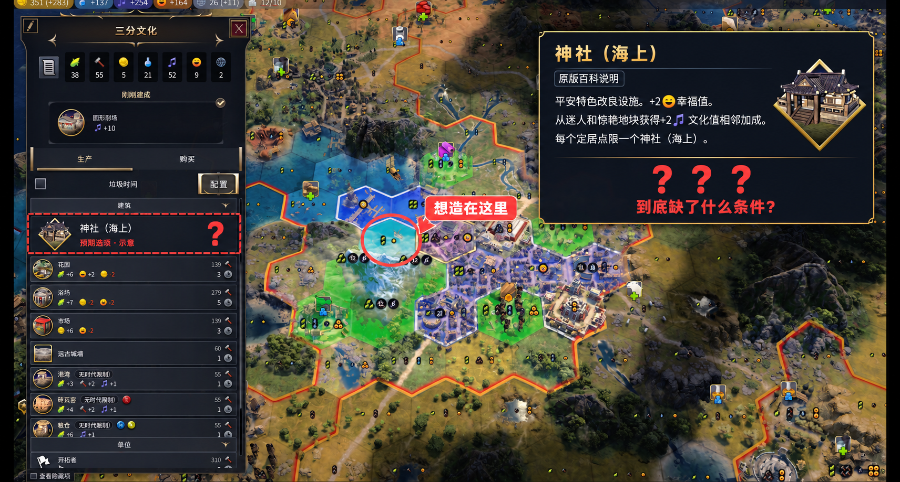

# 《文明7拯救计划》｜更好的中文支持

城在海边，海也在城里，神社却放不下来。

我这次做这个 Mod，就起因于下面这座城市。想造一个海上神社，翻来覆去看地块和说明，还是没弄明白卡在哪个条件。

点此添加图片注释，最多100字（可选）

*后期标注示意：红圈为想放置神社的地块，虚线框为预期出现的选项；右上角引用原版百科说明。*

后来翻查游戏安装目录里的规则配置文件，才确认海上神社要求：**海岸地块，且至少邻接一格平地**。配置中明确限定了“平地”，丘陵和山脉不能代替。**这项放置条件没有写进原来的中文说明。**

于是有了「更好的中文支持」：把建造条件、触发条件、加成范围这些会影响决策的中文说明写准确。只改错的、补缺的，原本正确的句子保持原样。

## 先把神社说清楚

原说明讲了收益和每城数量限制，却没把这些放置限制写出来。现在直接补进说明里：

> 从迷人和惊艳地块获得+2文化值相邻加成。

这句收益说明保留原文。只在原有说明后补充：

> 只能放置在与平地相邻的海岸地块上。相邻丘陵和山脉不满足条件。

这不会让原本不合法的地块突然能造神社，但至少能在规划城市时知道条件，而不是摆完建筑再猜原因。

## 具体改了哪些说明

当前版本涉及 **29 个文本条目**，包括同一内容的详细说明、悬浮提示和不同时代版本。下面合并完全相同的改动，只摘录涉及修改的句子；图标换成文字，红色删除线表示旧文，绿色表示新增或替换的部分。

**神社·总说明·说明**

− 原说明：每个定居点限一个神社（陆地）和一个神社（海上）。

+ 修改后：每个定居点限一个神社（陆地）和一个神社（海上）。<ins style="color:#089043;text-decoration:none">海上神社只能放置在与平地相邻的海岸地块上。相邻丘陵和山脉不满足海上神社的条件。</ins>

**神社（海上）·说明**

− 原说明：每个定居点限一个神社（海上）。

+ 修改后：每个定居点限一个神社（海上）。<ins style="color:#089043;text-decoration:none">只能放置在与平地相邻的海岸地块上。相邻丘陵和山脉不满足条件。</ins>

**神社（海上）·悬浮提示**

− 原说明：平安特色改良设施。

+ 修改后：平安特色改良设施。<ins style="color:#089043;text-decoration:none">只能放置在与平地相邻的海岸地块上。相邻丘陵和山脉不满足条件。</ins>

**弥勒寺·说明**

− 原说明：此定居点中拥有古典时代<del style="color:#c9272c">建筑和至少1</del>幸福值的所有区块+2文化值、+1生产力。无时代限制。必须放置在山脉旁。

+ 修改后：此定居点中拥有古典时代幸福值<ins style="color:#089043;text-decoration:none">建筑</ins>的所有区块+2文化值、+1生产力。无时代限制。必须放置在山脉旁。<ins style="color:#089043;text-decoration:none">幸福值建筑按游戏建筑分类判定，不以区块的幸福值总产出判定。加成按区块计算，不按建筑数量叠加。</ins>

**弥勒寺·悬浮提示**

− 原说明：此定居点中拥有古典时代<del style="color:#c9272c">建筑和至少1</del>幸福值的所有区块+2文化值、+1生产力。必须放置在山脉旁。

+ 修改后：此定居点中拥有古典时代幸福值<ins style="color:#089043;text-decoration:none">建筑</ins>的所有区块+2文化值、+1生产力。必须放置在山脉旁。<ins style="color:#089043;text-decoration:none">幸福值建筑按游戏建筑分类判定，不以区块的幸福值总产出判定。加成按区块计算，不按建筑数量叠加。</ins>

**巨蟒土丘·说明、巨蟒土丘·悬浮提示**

− 原说明：必须放置在草原上。

+ 修改后：必须放置在草原<ins style="color:#089043;text-decoration:none">平地</ins>上。

**南马都尔·说明、南马都尔·悬浮提示**

− 原说明：必须放置在与陆地相邻的水岸上，且此<del style="color:#c9272c">陆地</del>必须<del style="color:#c9272c">为</del>岛屿。

+ 修改后：必须放置在与陆地相邻的水岸上，且此<ins style="color:#089043;text-decoration:none">定居点</ins>必须<ins style="color:#089043;text-decoration:none">位于</ins>岛屿<ins style="color:#089043;text-decoration:none">上</ins>。

**汉长城·说明、汉长城·悬浮提示**

− 原说明：较之于其他特色改良设施，花费有所降低。

+ 修改后：较之于其他特色改良设施，花费<ins style="color:#089043;text-decoration:none">涨幅</ins>有所降低。

**汉朝·古典·说明**

− 原说明：建成科技值建筑时<del style="color:#c9272c">，首都</del>获得1人口。

+ 修改后：<ins style="color:#089043;text-decoration:none">首都</ins>建成科技值建筑时获得1人口。

**汉朝·探索·说明**

− 原说明：建成科技值建筑时<del style="color:#c9272c">，城市</del>获得1人口。

+ 修改后：<ins style="color:#089043;text-decoration:none">城市</ins>建成科技值建筑时获得1人口。

**汉朝·近世·说明**

− 原说明：建成科技值建筑时<del style="color:#c9272c">，所有定居点</del>获得1人口。

+ 修改后：<ins style="color:#089043;text-decoration:none">定居点</ins>建成科技值建筑时获得1人口。

**诺曼·古典·说明、诺曼·探索·说明、诺曼·近世·说明**

− 原说明：<del style="color:#c9272c">陆地单位，以及</del>与水岸相邻的驻防区块+5战斗力。

+ 修改后：与水岸相邻的<ins style="color:#089043;text-decoration:none">陆地单位及</ins>驻防区块+5战斗力。

**哈特谢普苏特·简介·说明**

− 原说明：每有1<del style="color:#c9272c">特色</del>资源，便+1文化值。

+ 修改后：每有1<ins style="color:#089043;text-decoration:none">种不同的</ins>资源，便+1文化值。

**哈特谢普苏特·能力·说明**

− 原说明：每有1<del style="color:#c9272c">特色</del>资源，便+1文化值，按时代叠加。

+ 修改后：每有1<ins style="color:#089043;text-decoration:none">种不同的</ins>资源，便+1文化值，按时代叠加。

**腓特烈·基础形态·说明**

− 原说明：完成一项科技精通时，在你的首都中获得一个步兵单位；<del style="color:#c9272c">你</del>建<del style="color:#c9272c">造有</del>科技值建筑的定居点中<del style="color:#c9272c">也</del>获得一个步兵单位。

+ 修改后：完成一项科技精通时，在你的首都中获得一个步兵单位；建<ins style="color:#089043;text-decoration:none">成一座</ins>科技值建筑<ins style="color:#089043;text-decoration:none">时，在建造它</ins>的定居点中获得一个步兵单位。

**腓特烈·另一形态·说明**

− 原说明：<del style="color:#c9272c">首次占领</del>定居点时获得一件巨作。展示的巨作+1文化值，按时代叠加。完成一项市政精通时，在你的首都中获得一个步兵单位；<del style="color:#c9272c">你</del>建<del style="color:#c9272c">造有</del>文化值建筑的定居点中<del style="color:#c9272c">也</del>获得一个步兵单位。

+ 修改后：<ins style="color:#089043;text-decoration:none">每座</ins>定居点<ins style="color:#089043;text-decoration:none">首次被你占领</ins>时获得一件巨作。展示的巨作+1文化值，按时代叠加。完成一项市政精通时，在你的首都中获得一个步兵单位；建<ins style="color:#089043;text-decoration:none">成一座</ins>文化值建筑<ins style="color:#089043;text-decoration:none">时，在建造它</ins>的定居点中获得一个步兵单位。

**亚述·古典·说明**

− 原说明：首次占领<del style="color:#c9272c">定居点</del>时获得一项科技和一部抄本。

+ 修改后：<ins style="color:#089043;text-decoration:none">每座定居点被你</ins>首次占领时获得一项科技和一部抄本。

**亚述·探索·说明**

− 原说明：首次占领<del style="color:#c9272c">定居点</del>时获得一项科技和一个遗物。

+ 修改后：<ins style="color:#089043;text-decoration:none">每座定居点被你</ins>首次占领时获得一项科技和一个遗物。

**亚述·近世·说明**

− 原说明：首次占领<del style="color:#c9272c">定居点</del>时获得一项科技和一件文物。

+ 修改后：<ins style="color:#089043;text-decoration:none">每座定居点被你</ins>首次占领时获得一项科技和一件文物。

**亚述王宫·说明**

− 原说明：此定居点中每展示有一件<del style="color:#c9272c">抄本</del>，便+2生产力。

+ 修改后：此定居点中每展示有一件<ins style="color:#089043;text-decoration:none">巨作</ins>，便+2生产力。

**紫禁城·说明**

− 原说明：<del style="color:#c9272c">所有</del>防御工事建筑、改良设施和奇观+1文化值和金币。无时代限制。<del style="color:#c9272c">此城市中的</del>防御工事+1观光值。

+ 修改后：<ins style="color:#089043;text-decoration:none">此城市中的</ins>防御工事建筑、改良设施和奇观+1文化值和金币。无时代限制。<ins style="color:#089043;text-decoration:none">己方所有</ins>防御工事+1观光值。

**紫禁城·悬浮提示**

− 原说明：<del style="color:#c9272c">所有</del>防御工事建筑、改良设施和奇观+1文化值和金币。<del style="color:#c9272c">此定居点中的</del>防御工事+1观光值。

+ 修改后：<ins style="color:#089043;text-decoration:none">此城市中的</ins>防御工事建筑、改良设施和奇观+1文化值和金币。<ins style="color:#089043;text-decoration:none">己方所有</ins>防御工事+1观光值。

**氏族社会 I·说明**

− 原说明：6格内每有一个他<del style="color:#c9272c">人拥有的</del>定居点，己方定居点便+2食物。

+ 修改后：6格内每有一个<ins style="color:#089043;text-decoration:none">其</ins>他<ins style="color:#089043;text-decoration:none">己方</ins>定居点，己方定居点便+2食物。

**氏族社会 II·说明**

− 原说明：6格内每有一个他<del style="color:#c9272c">人拥有的</del>定居点，己方定居点便+2食物和幸福值。

+ 修改后：6格内每有一个<ins style="color:#089043;text-decoration:none">其</ins>他<ins style="color:#089043;text-decoration:none">己方</ins>定居点，己方定居点便+2食物和幸福值。

## 游戏里和百科里都改吗？

都覆盖。Mod 更新了这些内容的详细说明和悬浮提示文本，百科及引用这些文本的游戏界面会一起读取修正版。

但范围是这 29 个条目，并不是把游戏里所有中文重新翻译一遍。此前 0.2.0 已在游戏运行环境中核对 33 条文本。本次 0.2.1 按“只纠错、补遗漏”收紧措辞，已通过离线检查，尚未安装和重新实机验证。

## 版本与来源

当前版本 0.2.1 已在 Steam 创意工坊发布。只修改简体中文说明，不增加 DLC 内容；没有对应 DLC，也不会因为装了这个 Mod 就解锁。

Steam 创意工坊订阅下载：更好的中文支持

https://steamcommunity.com/sharedfiles/filedetails/?id=3829402170

订阅后等待 Steam 下载完成，在游戏模组列表中启用，并重新启动游戏。

部分功能勘误参考徂川的《简中翻译修正和改进》（https://steamcommunity.com/sharedfiles/filedetails/?id=3524742152）及其公开修订清单（https://docs.qq.com/sheet/DWW94VHpnUFdHVmZS?tab=1nqnrb），再按当前游戏规则筛选、核对和补充。感谢原作者的整理。本版没有整合其中的译名替换、文风润色和其他 Mod 汉化。

如果你还碰到“照着中文说明做了，结果却不是那么回事”的地方，可以把原说明和具体场景留下来，继续按实际规则核对。
