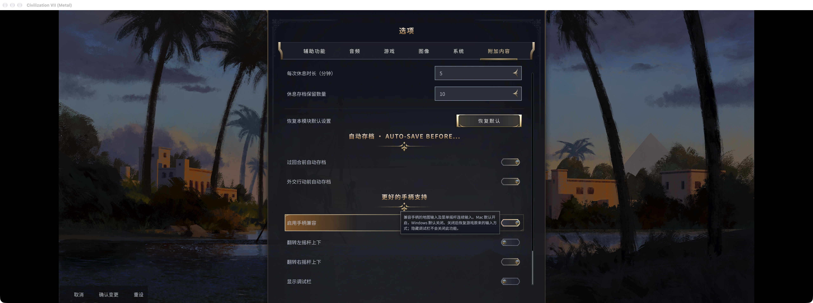

# 已发布图文

仅收录已有成功发布回执的文案。目录名与 `mods/` 对应；发布状态与时间见 [publications.json](publications.json)。

- [bilibili 文案](article-zh.md) · [已发布页面](https://www.bilibili.com/opus/1262385145689669638)
- [reddit 文案](reddit-en.md) · [已发布页面](https://www.reddit.com/r/CivVII/comments/1xdenjj/i_made_a_controller_support_mod_for_civ_vii_map/)

- [CivFanatics 英文文案](article-en.md) · [已发布页面](https://forums.civfanatics.com/threads/better-controller-support-for-civilization-vii.705221/)

## 已发布配图

