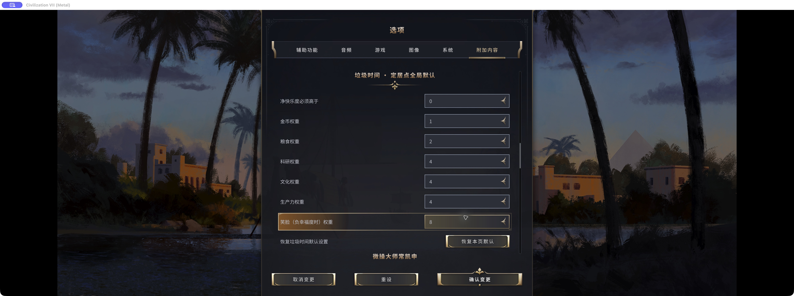
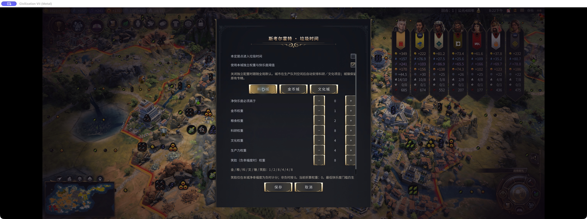
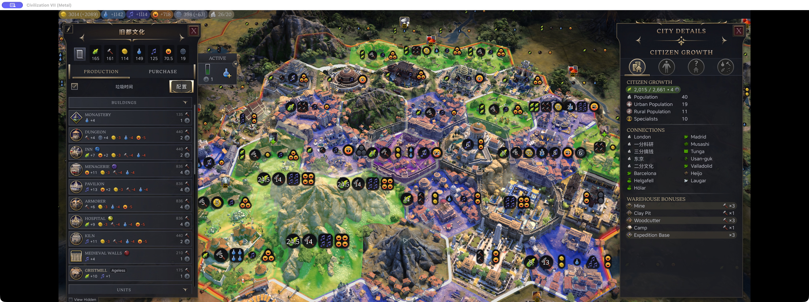
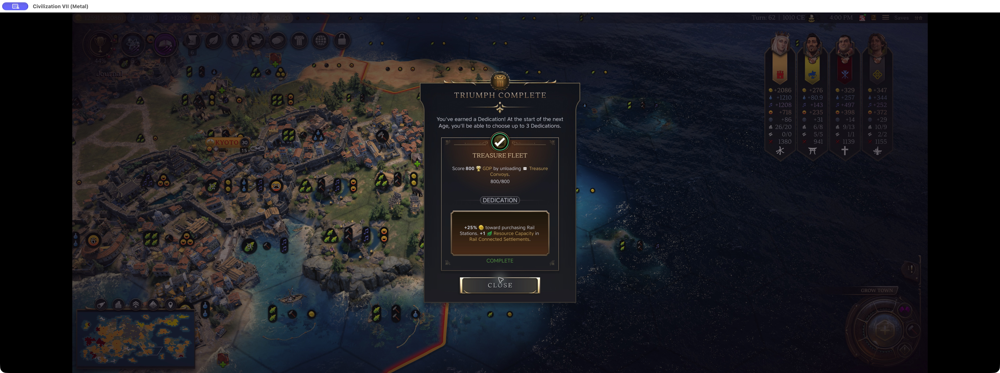
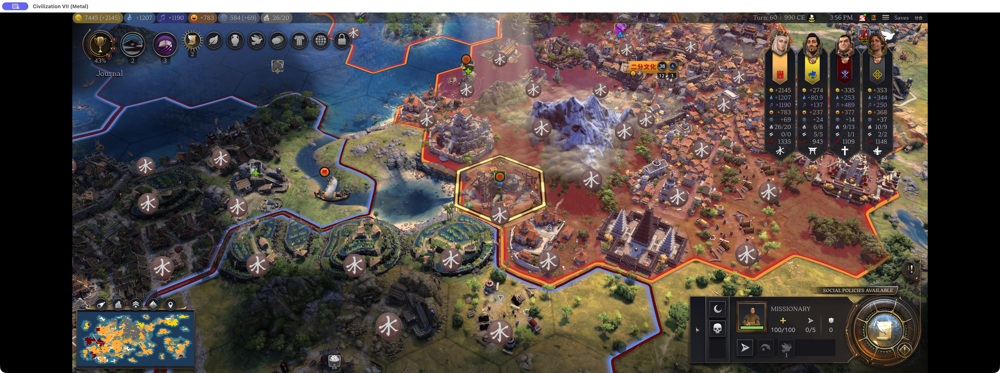
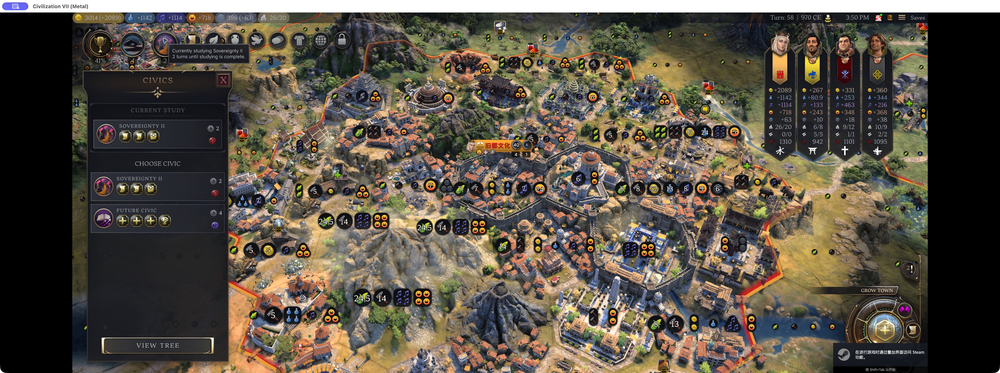

# Garbage Time — delegate the repetitive parts of late-game Civ VII

*Civ VII Rescue Project*

I'm the author of Garbage Time, an opt-in automation mod for single-player Civ VII. It handles selected repetitive jobs while leaving you in control of ending turns.

Once your victory plan is settled, idle units, population placement and research queues can become a roll call of routine decisions. This mod lets you delegate some of that work without handing over diplomacy or the whole turn.

## 1. Auto-rally armies

After a campaign, units may be scattered around the map with no immediate job. Parking them individually is another round of orders.

Military automation rallies them to the nearest reachable settlement you own, or a specific settlement of yours, then puts them to sleep on arrival. Packed units travel with their commander. It does not attack or declare war to complete a rally.

## 2. Auto-assign population

From the Exploration Age onward, a dozen settlements can grow at once. Pick a tile here, place a specialist there, then do the rounds again. Your cities already have clear roles; assigning every new population point becomes a chore.

Enabled settlements allocate new population to legal expansion tiles or specialist slots using yield weights. Idle cities choose an available science or culture project without clearing an existing queue. If the net-happiness threshold is not met, allocation pauses and raises a reminder. It does not build happiness buildings for you.

### Yield weights

Weights score net yield changes; they do not convert Food into spendable Gold. Gains are positive and upkeep costs are negative. Multiply each signed change by its weight, then add them together:

| Net yield change | Default weight per point |
| --- | --- |
| Gold | 1 |
| Food | 2 |
| Science | 4 |
| Culture | 4 |
| Production | 4 |
| Happiness | 8 when current net Happiness is negative; otherwise 0 |

For example, +2 Food and +1 Production score 2×2 + 1×4 = 8. A different tile with +1 Science and +3 Gold scores 7. If both choices are legal and pass the happiness threshold, the first wins. Yield losses subtract points too.

Specialist upkeep counts too. Suppose a slot adds 2 Science and 2 Culture, consumes 2 Food and 2 Happiness, and changes no other yields:

**Score = 2×4 + 2×4 + (−2)×2 + (−2)×effective Happiness weight.**

With nonnegative current net Happiness, the effective Happiness weight is 0, giving a score of 12. With negative current net Happiness, its default weight is 8, giving −4. Actual gains and upkeep come from the game preview; not every specialist always costs exactly 2 Food and 2 Happiness.

The happiness threshold is a separate requirement: both current and projected net Happiness must be strictly above it. The default is 0, so a city with negative net Happiness pauses before scoring. Even when Happiness has zero scoring weight, upkeep can disqualify a slot: starting at 2 net Happiness and spending 2 leaves exactly 0, which fails the default threshold.

### Global defaults

Open Options → Additional Content and find Garbage Time’s yield weights. Each weight ranges from 0 to 100; set the net-happiness threshold separately, then confirm your changes. Settlements without an individual override inherit these values.

For an idle city, the available Science or Culture project with the higher weight is selected. Science wins a tie; a project weighted at zero is excluded.

### Per-city priorities

In the production panel, open Configure beside Garbage Time. Enable management for that settlement, select its independent weights and happiness threshold, adjust the values, then Save. With the override unchecked it inherits global defaults; Cancel discards the draft.

The Science City preset raises Science to 8; Culture City raises Culture to 8; Gold City raises Gold to 4. Other weights stay at their defaults. Under the Science preset, +1 Science and +3 Gold now score 11, beating the +2 Food and +1 Production option at 8.

These weights govern population and city projects. Background resource assignment follows the yield preferences set separately in Resource Planner.

## 3. Auto-return and unload treasure

When you are far ahead of the AI and nobody dares touch your treasure fleets, bringing each one home and unloading it becomes another round of clicks. Let automation handle the trip and collect the reward.

Treasure automation heads for the nearest reachable homeland settlement. Once the fleet is within that settlement and the game permits unloading, it redeems the treasure and consumes the fleet for the normal reward. It does not have to reach the city-center tile.

## 4. Auto-spread religion

Once your religion is far ahead of the AI, spreading it to the remaining settlements can become tedious. Find a target, move a missionary, spread, repeat. Automation handles that cleanup.

Religious automation looks for the nearest reachable eligible settlement that has not adopted your religion, then spreads when permitted. The default scope is your own country; city-states and other countries can be included. Urban and rural religion are considered separately.

## 5. Auto-research techs and civics

During cleanup research, choosing the next short technology or civic may no longer need a long deliberation.

The mod preserves current research and selects an available unfinished node when a new one is needed, preferring shorter ordinary research before repeatable future nodes. Policies, age-transition choices, leader attributes and diplomacy remain yours.

## 6. Auto-assign resources

Science cities still want Science; production cities still want Production. Set those preferences once, then let automation slot in resource cards as they become available.

With Resource Planner and its Resource Re-sorts dependency enabled, Garbage Time can apply your remembered settlement preferences each turn. It uses unassigned resources by default and waits for the game's resource lock to lift. It does not create trade routes or choose those preferences for you.

## Availability and testing

Workshop version 0.1.4 runs on the local player’s single-player turn. Everything starts disabled; new games and new ages require enabling automation again. Settlements are enabled individually from their production panel. These are real game actions, including movement and population/resource assignment.

The six scenarios shown here were checked on Mac 1.5.0 Metal on October 24, 2026, including treasure redemption and background resource allocation. This is not a full unattended campaign or coverage of every unit and mod combination. Some mod controls still display Chinese in the English game UI. Physical-controller acceptance remains incomplete. It does not end turns, select policies or make diplomatic decisions.

[Garbage Time on Steam Workshop](https://steamcommunity.com/sharedfiles/filedetails/?id=3822254009)

For resource automation: [Resource Planner](https://steamcommunity.com/sharedfiles/filedetails/?id=3822254182) and [Resource Re-sorts](https://steamcommunity.com/sharedfiles/filedetails/?id=3507102808).

You still finish the game yourself. The goal is to leave more of your attention for decisions you actually want to make.
