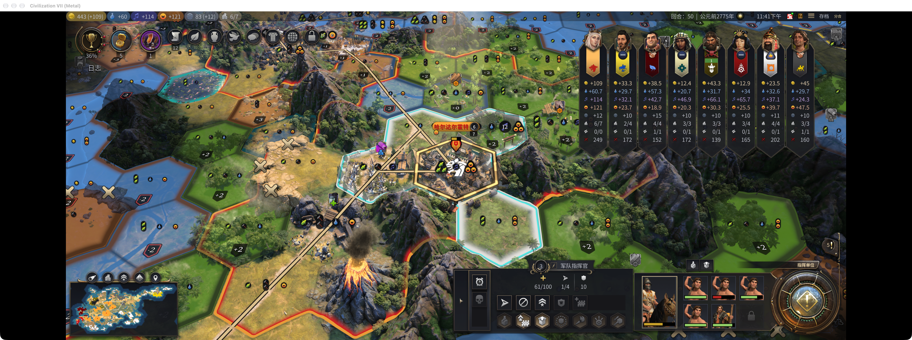
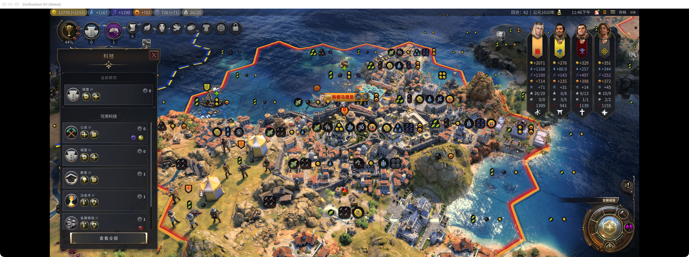

# 《文明7拯救计划》｜垃圾时间

先说结论：这个 Mod 可以接手后期的一部分重复操作，哪些事情交出去，由你主动开启。它不会替你按下一回合。

假设一局已经大致确定往哪条胜利走，剩下的城市照常长人口，研究照常做，闲下来的部队还在等命令。每件事单独看都不难，凑在一起却让一回合变成了点名。

「垃圾时间」想省的就是这部分功夫。重要的选择还在，已经不想逐个安排的事情，可以先交出去。

## 1. 自动集结军队

一场仗打完，部队散在各处。如果暂时没有下一场任务，逐个找地方停好，也要花掉一轮操作。

军事自动化可以让部队前往最近可达的己方定居点，或者向指定定居点集结，抵达后休眠。装在指挥官里的部队跟着指挥官一起走。它不会为了集合主动攻击或宣战。

## 2. 自动上人口

到了探索时代，经常是十几个城一起涨人口。这个城挑地块，那个城上专家，点完一圈又来一圈。后期各城的发展方向早就定了，逐城上人口却越来越琐碎。

给定居点开启托管后，新增人口会按产出权重选择合法扩张地块或专家岗位。空闲城市会安排可用的科研或文化项目，已有生产队列继续保留。净幸福度过不了你设的门槛时，会停下来提醒，而不是继续硬塞人口。它不会自动替城市建设幸福度建筑。

### 产出权重

这里的“比例”是比较产出的权重，不会把游戏里的粮食兑换成金币。计算时看净产出：收益记正数，维护费记负数，每一项乘上对应权重后相加。

| 产出净变化 | 每点默认权重 |
| --- | --- |
| 金币 | 1 |
| 粮食 | 2 |
| 科研 | 4 |
| 文化 | 4 |
| 生产力 | 4 |
| 笑脸 | 当前净幸福度为负时8；非负时0 |

例如，一个地块增加2粮食、1生产力，得分是2×2＋1×4＝8；另一个增加1科研、3金币，得分是1×4＋3×1＝7。在都合法、都通过幸福度门槛时，会优先前者。减产也会按对应权重扣分，不能只看新增的一项。

专家的维护费也得算进去。假设一个岗位增加2科研、2文化，同时消耗2粮食、2笑脸，没有其他产出变化，那么：

**得分＝2×4＋2×4＋(−2)×2＋(−2)×笑脸有效权重。**

当前净幸福度非负时，笑脸有效权重为0，这个例子得12分；当前净幸福度为负时，默认笑脸权重为8，得分就是−4。实际收益和维护费以游戏预览为准，不把所有专家都当成固定的“−2粮食、−2笑脸”。

幸福度还有一道独立门槛：当前净幸福度，以及预计分配后的净幸福度，都必须严格高于设定值。默认是0，恰好等于0也会暂停自动分配人口。因此，默认设置下净幸福度为负的城市会先暂停，不进入评分；即使笑脸计分权重为0，维护费也可能让岗位过不了门槛。例如当前净幸福度为2，再扣2笑脸后恰好为0，就不能选。

### 全局设置

进入“选项 → 附加内容”，找到垃圾时间的产出权重设置。六项权重都可以在0～100之间调整，“净快乐度必须高于”单独设置；修改后点击“确认变更”。没有开启独立配置的定居点会跟随这套默认值。

空闲城市的科研／文化项目会比较这两项权重，选择权重更高且可用的项目；同分时优先科研，权重为0的项目不选。

### 单城设置

在城市生产面板的“垃圾时间”旁点击“配置”。可以单独开启本定居点托管，勾选“使用本城独立权重与快乐度阈值”，再调整六项比例和幸福度门槛。未勾选独立配置时沿用全局默认，改完点击“保存”，不想保留就点“取消”。

“科研城”预设把科研权重提到8；“文化城”把文化提到8；“金币城”把金币提到4，其余权重沿用默认。比如科研城里，刚才1科研、3金币的地块得分会变成11，高于2粮食、1生产力的8分。

这套比例用于人口分配和城市项目。后台插入资源则沿用「资源规划」里标记的产出倾向，需要在资源面板里设置。

## 3. 宝藏船自动靠港卸货

当你已经遥遥领先 AI，连宝藏船都没人敢碰时，还要逐艘安排返航、靠港、卸货，就只剩重复点鼠标。直接交给自动化，让它们自己回家领奖。

开启宝藏船自动化后，船会前往最近可达的本土定居点。进入定居点范围、原版允许卸载时，就会兑现宝藏并消耗这艘船，奖励按原版结算，不必一定挤到城市中心。

## 4. 自动传教

宗教已经遥遥领先 AI，接下来无非是把剩下的城一个个传过去。找目标、赶路、点传播，重复多了也很无聊。这段收尾就交给自动传教。

宗教自动化会在允许的范围里寻找最近可达、尚未信奉本宗教的定居点，抵达后在原版允许时传播。默认只处理本国，需要向城邦或其他国家传播时再扩大范围；城市和乡村的信仰也会分别考虑。

## 5. 自动研究科文

到了补科技、补市政的阶段，有些选择已经不需要每次停下来研究一遍。提醒还是会照常弹，进度也照常等着你点。

科技和市政自动化会保留正在做的研究，需要下一项时再选可研究、未完成的节点，优先预计用时较短的普通项目，最后才处理可重复的未来研究。政策、时代选择、领袖属性和外交决定仍然留给你。

## 6. 自动插资源卡

科研城要科研、生产城要生产，这个分工没变，每次资源解锁却还得再打开面板插一轮卡。设好倾向，之后就让它自动插。

搭配「资源规划」及它依赖的 Resource Re-sorts，垃圾时间可以每回合调用按倾向分配，沿用你为各定居点设好的方向。默认只动空闲资源；没有开放分配时会等原版解锁。它不会替你建立贸易路线，也不会自己猜哪座城该走什么倾向。

## 适用范围

工坊版本为 0.1.4，仅在单人游戏的本地玩家回合执行。所有自动化默认关闭，新存档和新时代需要重新开启；定居点在生产面板里单独开启。它会实际移动单位、分配人口和资源，请只交出已经愿意交出的操作。

本文六个场景已于 2026-10-24 在 Mac 1.5.0 Metal 实机检查，包括宝藏兑现和后台资源分配；不代表整局无人值守或全部兵种、第三方 Mod 都已验证。英文游戏界面中，部分 Mod 控件仍显示中文。实体手柄尚未完整验证。不会自动结束回合、选政策或做外交决定。

[Steam 创意工坊：垃圾时间](https://steamcommunity.com/sharedfiles/filedetails/?id=3822254009)

后台资源分配所需：[资源规划](https://steamcommunity.com/sharedfiles/filedetails/?id=3822254182) · [Resource Re-sorts](https://steamcommunity.com/sharedfiles/filedetails/?id=3507102808)

垃圾时间还是得自己打完。至少那些已经不想再做一遍的日常操作，可以少占一点精力。
