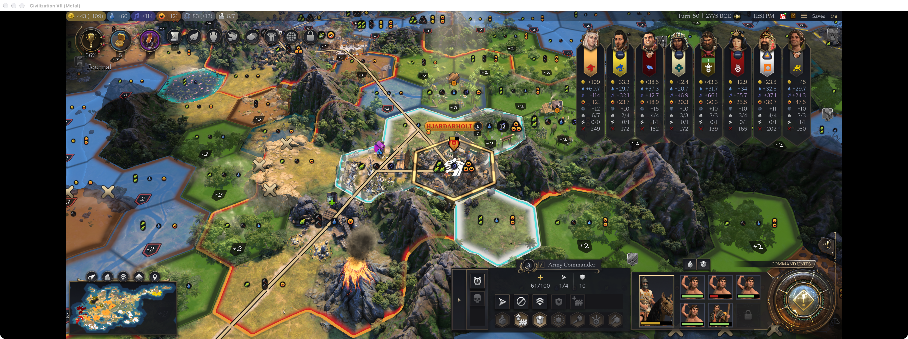
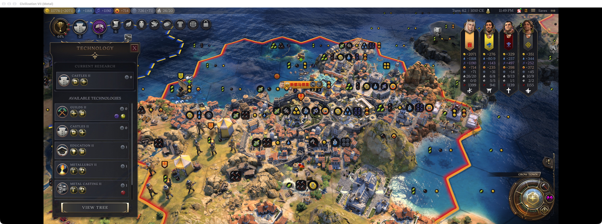
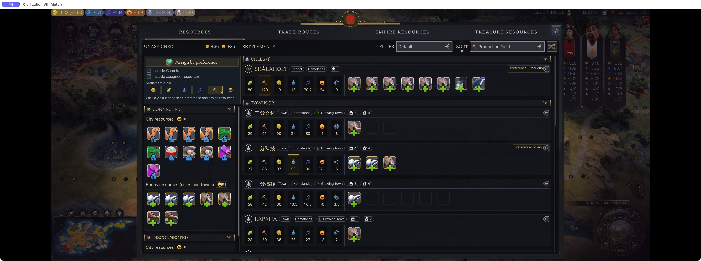

# Garbage Time: opt-in late-game chores automation for single-player Civ VII

I'm the author of Garbage Time. It handles the repetitive jobs that pile up once you are comfortably ahead of the AI.

From the Exploration Age onward, a dozen settlements can grow at once. Picking a tile or specialist in every one gets old fast. Treasure fleets nobody threatens and missionaries spreading an already dominant religion can feel much the same.

The six jobs are auto-rallying armies, assigning population, returning and unloading treasure fleets, spreading religion, researching techs and civics, and assigning resource cards. Idle cities can also keep running science/culture projects. Resource assignment requires Resource Planner plus Resource Re-sorts.

Everything starts off. New games and ages need enabling again. It never ends the turn or chooses diplomacy, policies or age-transition decisions. Its orders do change the current game, so enable only the jobs you intend to hand over.

The screenshots below show one Army Commander back home and asleep, Castles II filling an empty technology queue, and resources assigned in the background. These examples use Workshop 0.1.4 on Mac 1.5.0 Metal; they do not establish a full unattended campaign or physical-controller support. Some mod controls still display Chinese in the English game UI.

What repetitive late-game action would you most want to delegate?

Population choices use weighted net yields, including negative upkeep. For a hypothetical specialist with +2 Science, +2 Culture, −2 Food and −2 Happiness, the default score is **2×4 + 2×4 + (−2)×2 + (−2)×effective Happiness weight**. Happiness has weight 0 while current net Happiness is nonnegative, or 8 otherwise. Both current and projected net Happiness must still exceed a separate threshold, default 0. Set global weights in Options → Additional Content, or open Configure in a city for an override.

[Garbage Time on Steam Workshop](https://steamcommunity.com/sharedfiles/filedetails/?id=3822254009)

For resource automation: [Resource Planner](https://steamcommunity.com/sharedfiles/filedetails/?id=3822254182) and [Resource Re-sorts](https://steamcommunity.com/sharedfiles/filedetails/?id=3507102808).
