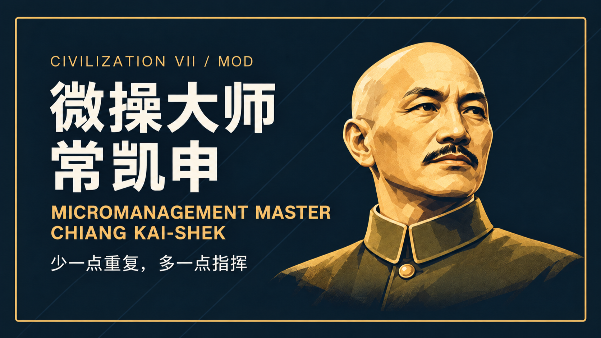

# 微操大师：已发布图文归档

目录与 `mods/civ7-micromanagement-master-chiang-kai-shek` 一致。本文案记录发表时的版本与验证范围，不代表最新代码状态。

| 平台 | 归档文案 | 发布页 | 正文配图 |
|---|---|---|---|
| bilibili | [article-zh.md](article-zh.md) | [已发布](https://www.bilibili.com/opus/1262974101687894032) | 9 |
| civfanatics | [article-en.md](article-en.md) | [已发布](https://forums.civfanatics.com/threads/705247/) | 9 |

正文、配图来源、文件 SHA-256、平台核验时间及归档时的格式调整见 [publications.json](publications.json)。截图沿用发布时的真实素材，未重拍或生成游戏画面。

B站为线上原版介绍，CivFanatics 为已公开的战报风格英文修订，两者并非互译的同一稿。平台仍使用的历史名称/封面按原文归档。Reddit 当前修订被过滤，仅记录链接与状态；未发布的中文战报稿和轮廓封面不收录。
