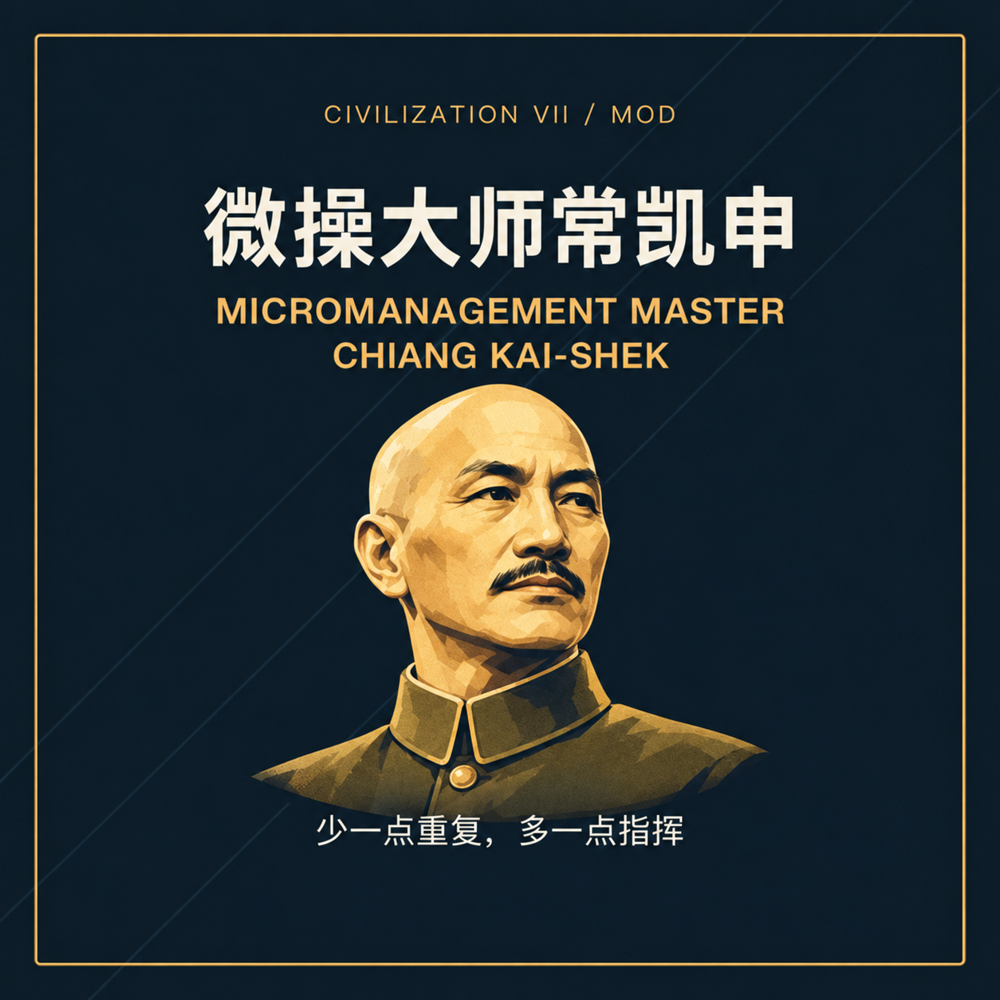
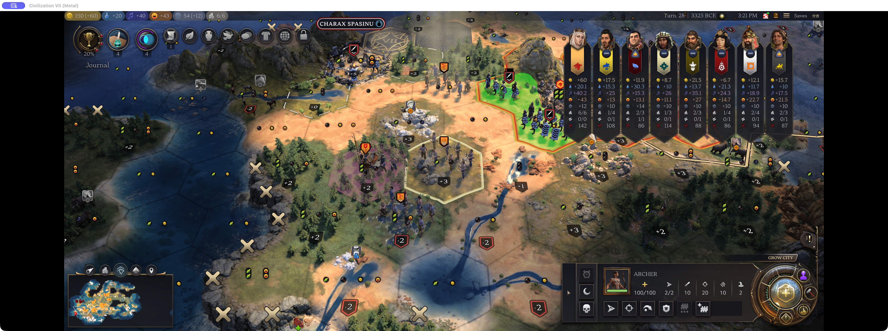
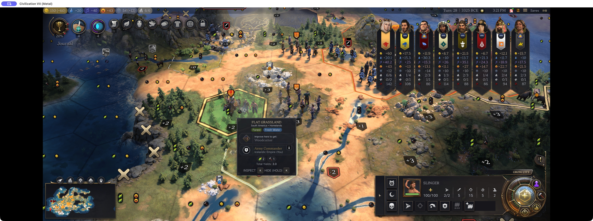
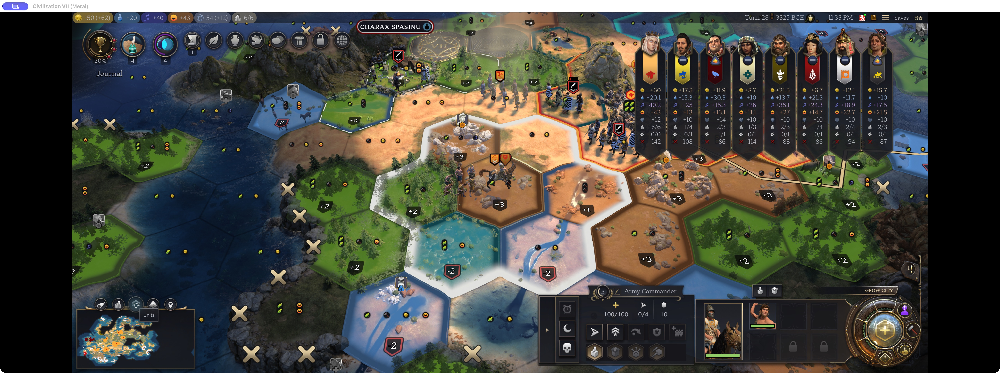
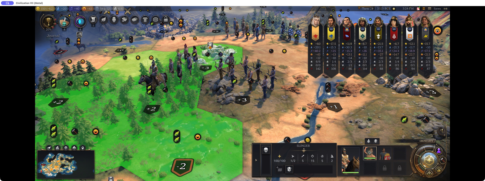
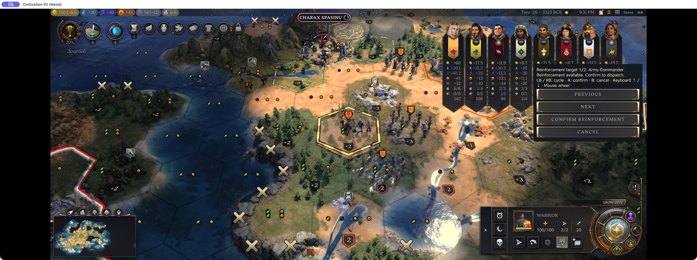
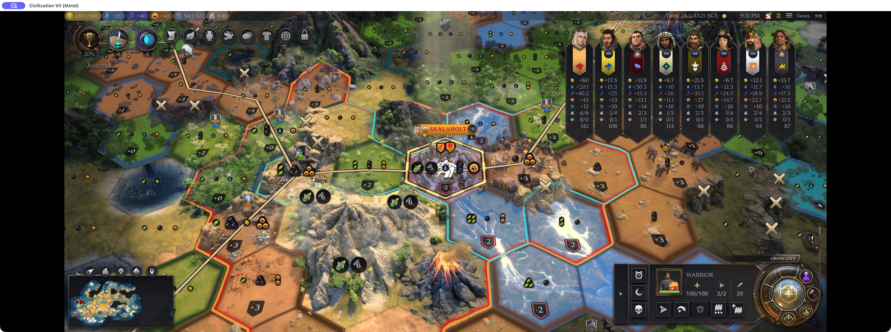
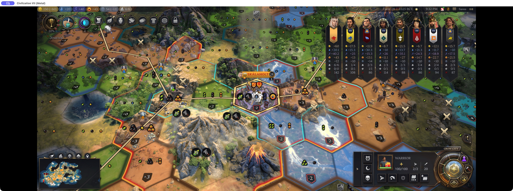
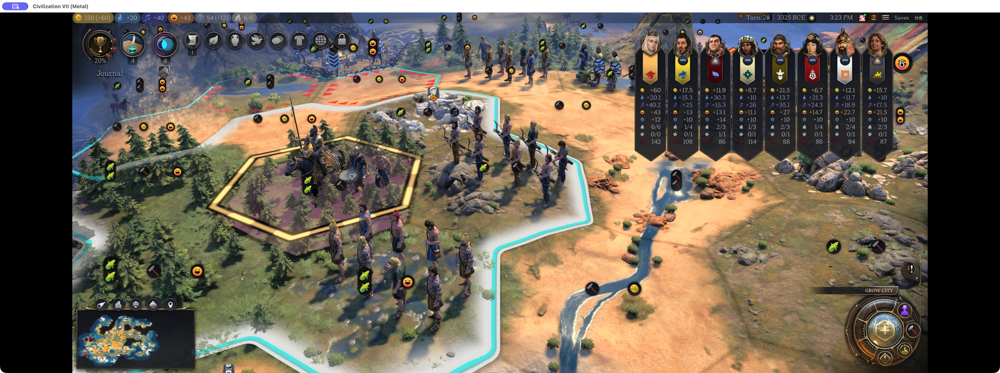

# Micromanagement Master Chiang Kai-shek — fewer clicks for ranged units and commanders

*Civ VII Rescue Project*

Commanders, survey the map. Our archers hold the heights. Reinforcements stand ready. The deployment is sound; the prospects are excellent. All that remains is to order the attack.

First, select the unit. Then visit its panel. Then select Attack. Then return to the map. The enemy has not moved, but my cursor has already completed a campaign.

I'm the author of Micromanagement Master Chiang Kai-shek. I originally made it to improve controller play, then found that mouse players could use fewer trips through the panels too. That is why it became a separate mod instead of part of Better Controller Support.

Here is the briefing: six shorter routes to the orders you already intended to give. You still choose the targets and positions.

## 1. Select to attack

The archer is selected. The enemy is in sight. My intention should be reasonably clear. Yet on a controller, I must select the unit on the map, visit its panel to select Attack, and return to the map to select the enemy. One soldier, three journeys through headquarters.

A mouse right-click is quicker—until blocked line of sight turns my intended shot into a move order. The archer leaves its position before the battle has properly begun.

With a legal, visible target available, selecting a ranged unit now opens attack targeting directly. The next click chooses the enemy. The firing order remains yours.

## 2. Select to regroup

There is a time to fight and a time to pack up. With no enemy in attack range and the commander standing beside the unit, I usually want the army assembled for a march.

Normally the order must travel through the unit panel and back to the map. The soldier and commander are one tile apart; apparently their paperwork takes the long road.

Now select the unit, then click the eligible adjacent commander to pack it. A commander on the same tile works too. If a ranged attack is available, attack targeting still takes priority.

## 3. Prevent swaps

The order was to join the commander. Instead, another friendly unit on that tile swaps places with the arriving soldier. Movement is spent, the formation is disturbed, and an impressive amount of activity has accomplished very little.

From the default mouse mode, right-clicking a tile shared by a friendly commander and another friendly military unit now joins the commander instead of swapping. The arriving unit packs up; the other unit keeps its post.

If joining is unavailable, the helper blocks the accidental swap and explains why. A tile containing only the commander keeps normal movement. Cancel any active attack or deployment targeting before issuing this right-click order.

## 4. Deploy units in sequence

The first unit goes here, the second holds that position, the third prepares to finish the target. The plan is settled. I deploy the first soldier—and lose commander focus.

Select the commander again. Open the roster again. Select the next soldier. Must headquarters reconvene for every man leaving camp?

Select a packed unit's portrait to open deployment targeting. After deployment, commander focus can stay in place and the next military unit with movement and a legal deployment tile is selected and highlighted. Choose its position to continue. Civilians and scouts are skipped by the automatic selection.

## 5. Faster quick reinforcement

Quick reinforcement is quick for the troops. Their commander still has to select the new unit, choose Reinforce, and drag the camera across the country to find the destination. The front needs soldiers; I am conducting a map tour.

If you own exactly one commander and that commander is eligible, Reinforce dispatches directly. If you own several, you still choose, even when only one is currently eligible. An intended reinforcement for the eastern front should not quietly become a posting to the west.

The picker starts at the nearest eligible commander, skipping destinations that are too close, full, or otherwise unavailable. Use Previous/Next to inspect another. Dispatch requires confirmation; looking at a commander is not a marching order.

Cancel with the panel button or a map right-click and the camera returns to the original unit, still selected. Having withdrawn the order, we should at least remember where we left the soldier.

## 6. Red warning for reduced commander movement

One more matter, commanders. Every soldier has deployed, but the commander loses mobility without troops packed inside. Do not plan the next march as though the army were still assembled.

The pink base is a reminder to check that commander's reach before arranging the next move. A beautifully positioned firing line is less useful if its commander gets left behind.

The exact condition matters: the base appears when no units are packed. It is not a general warning for every partially spent movement pool.

## Usage notes

A confident briefing does not override the game's rules. Movement, attack counts and legal targets still apply. Right-click joining is mouse-only.

Keyboard Up switching and Escape camera return still have issues; use the panel buttons and map right-click for now. Mouse-wheel and physical-controller switching have not completed live validation.

[Micromanagement Master Chiang Kai-shek on Steam Workshop](https://steamcommunity.com/sharedfiles/filedetails/?id=3822253543)

Whether the enemy follows my plan is another question. At least my own orders can reach the troops without another tour of the unit panel.
