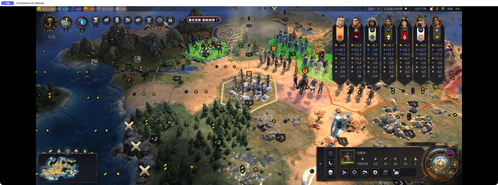
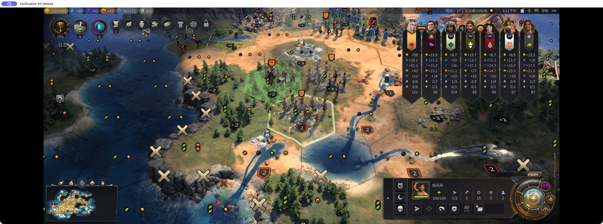
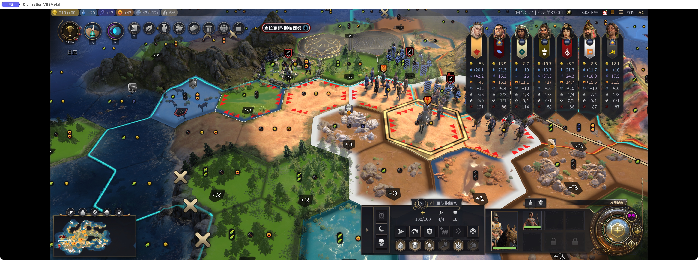
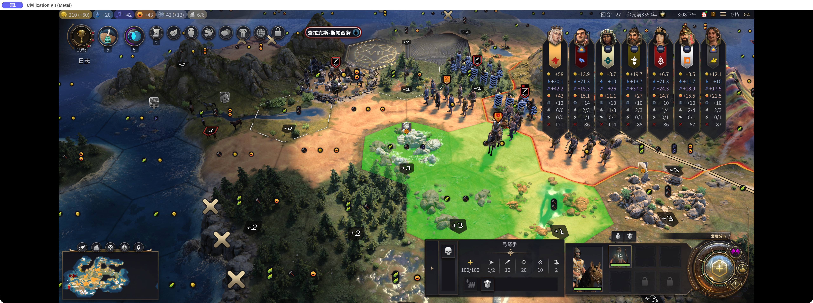
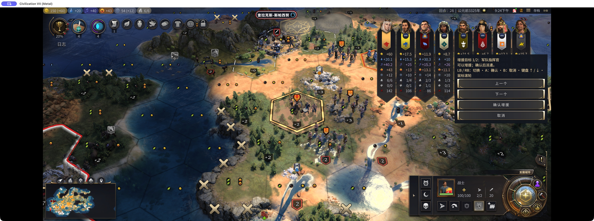
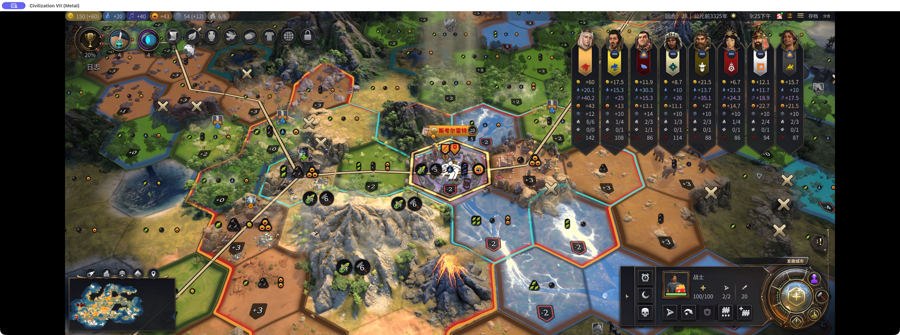
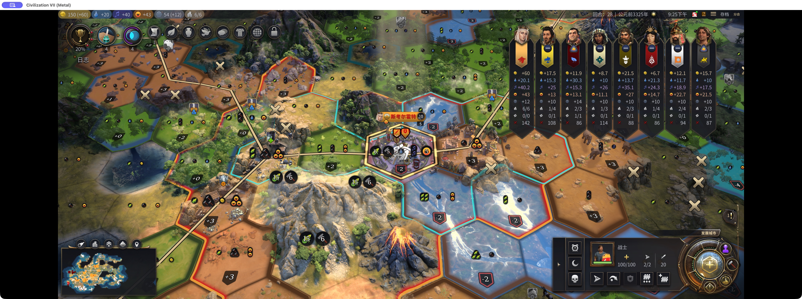
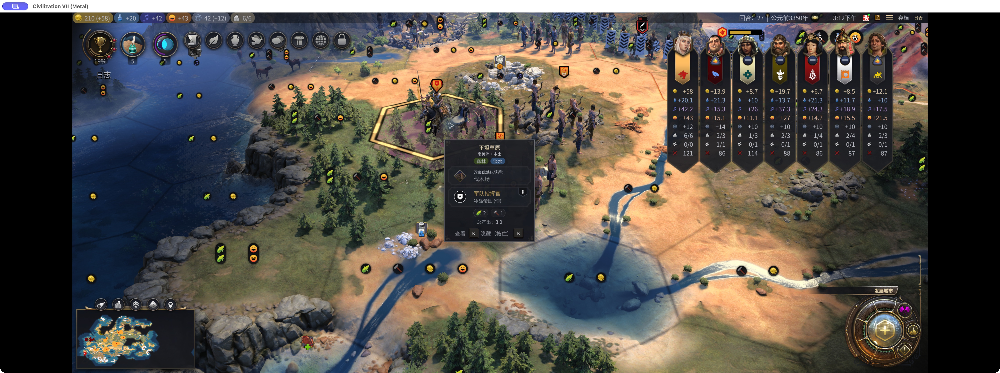
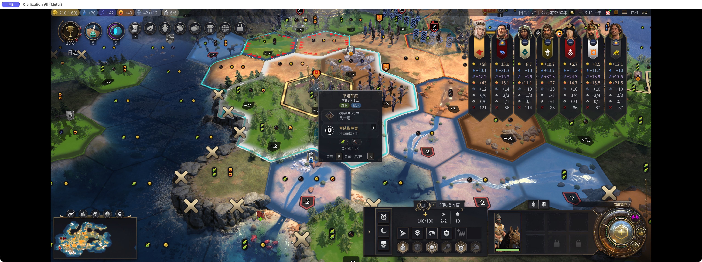

# 《文明7拯救计划》｜微操大师常凯申

这个 Mod 最初是为了改善手柄游玩体验做的。后来发现，用鼠标玩也能少点不少按钮，所以我没有把这些功能放进「更好的手柄支持」，而是单独做成了「微操大师常凯申」。

这个 Mod 帮你省掉远程攻击、部队进出军队和增援时的一些重复点击。目标怎么选、兵往哪放，还是自己决定。

打仗时想的是这一轮谁先射、谁来补刀，手上却得先把同一排按钮反复点一遍。几支部队还好，战线一拉长，微操的时间有一部分花在了找入口上。

## 1. 选中即进攻

打仗时，大部分情况下我在地图上选中一个单位，就是准备进攻了。用鼠标可以右键攻击，但有时点快了，没注意到视线被挡、其实打不到，右键就变成了移动。用手柄更折腾：先在地图上选中己方单位，再去单位面板选攻击，最后回到地图上选敌人。

有可攻击的可见目标时，选中远程单位就直接进入攻击选格，下一步直接选敌人。省掉中间翻单位面板的操作，具体打谁仍由你确认。

## 2. 选中即归队

攻击范围内没有敌人，部队又站在指挥官旁边，这时候选中它，往往就是想收兵急行军了。原来的操作却是：先在地图上选中己方单位，再到单位面板选归队，最后回到地图上选指挥官。

现在直接在地图上选中部队，再点一下旁边的指挥官，就归队了。同格有可加入的指挥官也一样；如果有可攻击的敌人，仍然优先进攻。

## 3. 防止换位

想把部队收进指挥官，右键却变成了和同格的友军换位，白白消耗行动力，还打乱了站位。

在默认操作状态下，右键进入同时有己方军事指挥官和其他己方军事单位的格子，会把换位改为加入指挥官，节约行动力、防止误操作。暂时不能加入时会提示并阻止误换位；只有指挥官、没有其他军事单位的格子仍按正常移动处理。若正在选攻击或部署目标，先取消当前操作。

## 4. 连续展开军队

把几名部队从指挥官肚子里派出来，最烦的是派完一个就丢了焦点，又得重新点指挥官，再点下一个兵。明明只是连续摆几个位置，却要反复打开同一个面板。

选中成员头像就进入部署选格。派出一名后，保持指挥官焦点，并自动选中下一名还有移动力、可以派出的军事单位，当前头像会高亮。接着点下一个位置，就能继续展开军队；平民和侦察单位不会被自动接着选中。

## 5. 更快速的快速增援

现在的“快速增援”，只是部队赶路快了，玩家操作起来可不快：先选单位，再点增援，还得回到地图上，把视角一路拖到远处，找到想增援的指挥官。

总共只拥有一位指挥官，而且他符合增援条件时，点击增援就直接派遣。拥有多位指挥官时，即使只有一位当前可增援，也仍由你选择。

选择时默认看最近的可增援指挥官，太近、已满等暂时不能接收增援的目标会先跳过。也可以用面板的“上一个／下一个”切换，确认后才派兵。点击取消或在地图上右键，镜头回到原来的兵，保持选中。

## 6. 指挥官移动力未满标红

打仗时把兵全派出去了，注意力都在谁先打、谁补刀，很容易忘记指挥官的移动力也会下降。

粉色底座提醒你：这位指挥官已经没有收纳部队，走位时别再按带兵时的机动力安排。提醒在肚子里没有兵时出现，不是所有剩余移动力不足的指挥官都会变粉色。

## 适用范围

操作仍受原版移动力、攻击次数及合法目标限制；右键加入只适用于鼠标。

[Steam 创意工坊：微操大师常凯申](https://steamcommunity.com/sharedfiles/filedetails/?id=3822253543)

兵怎么打还是得想，能省的是把已经想好的命令重复翻出来的那几下。
