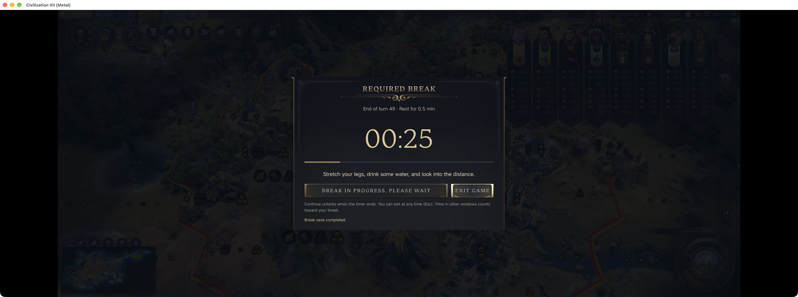
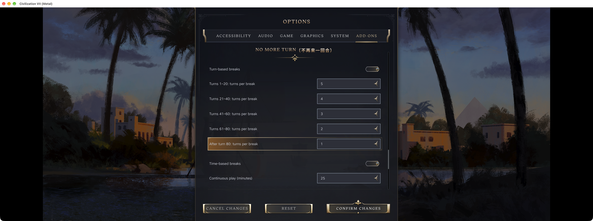
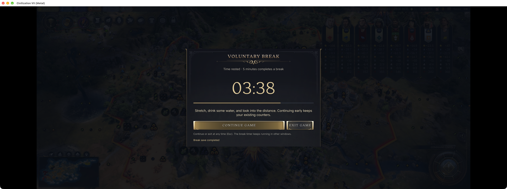

# No More Turn — breaks that do not depend on finishing one more turn

*Civ VII Rescue Project*

I'm the author of No More Turn, a single-player Civ VII mod for timed breaks, turn-based breaks and a nightly stopping time.

A wonder is almost finished, a technology is about to unlock, and your army has just arrived. There is always a reasonable excuse for one more turn. This mod lets you set the stopping point before those excuses start piling up.

## 1. Timed breaks: a reverse Pomodoro

Late-game turns can take a while. Promising to stop after two more turns is not much of a time limit.

The default is a five-minute break after 25 minutes of play. The break can start during a turn, so you do not have to finish managing every settlement before stepping away. Resume after the countdown.

## 2. Turn-based breaks

Five early turns and five late turns are very different amounts of play.

Turn-based breaks become more frequent as the game progresses: the new defaults use the reverse Fibonacci sequence of 13, 8, 5, 3 and 2 end-turn actions across successive 20-turn stages. From turn 81 onward, the default is a break every two turns. Version 1.8.6 includes these defaults. Existing configurations are preserved; Reset applies the new values. The settings screenshot below was captured with 1.8.5 and shows the previous defaults. Adjust the intervals to suit your pace.

## 3. Voluntary breaks

If you have already stepped away, another break immediately afterward would be annoying.

After one idle minute, a voluntary-break panel appears and includes the time you have already spent away. Five continuous idle minutes completes a break and resets both the time and turn counters. You can resume early; doing so keeps your earlier play progress instead of treating a brief pause as a full break.

## 4. Restricted hours: early to bed, early to rise

Stopping after the current round can turn into starting the next one before you notice.

The night restriction defaults to 22:00–07:00 in your computer's local time. It blocks gameplay during that window while leaving Exit Game available. When the window ends, it does not automatically advance a turn. Adjust or disable the schedule in the game's Add-ons options to fit your routine.

## 5. Autosave before a break

Once you have decided to stop, wondering whether you saved can pull you back into the game.

Each break attempts a separate local checkpoint and shows its save status on the panel. It keeps the newest ten break saves by default, removing older break saves only after a new one succeeds. This retention limit spans campaigns; normal autosaves, quicksaves and other manual saves are not part of that cleanup. Check for a successful save before exiting.

## Availability and testing

Workshop version 1.8.6 supports single-player, English and Simplified Chinese. Review the default 22:00–07:00 night restriction before enabling it. Break-save retention is shared across campaigns, so keep separate saves for important milestones.

The scenarios shown here were captured with Workshop 1.8.5 on Mac 1.5.0 Metal. Temporary demonstration timings are identified in the captions. This capture pass does not verify other platforms or physical controllers. The restriction applies inside the game; it does not lock the computer.

[No More Turn on Steam Workshop](https://steamcommunity.com/sharedfiles/filedetails/?id=3815557333)

It cannot decide whether you should start a game tonight, but it can give “just a little while” a concrete stopping point.
