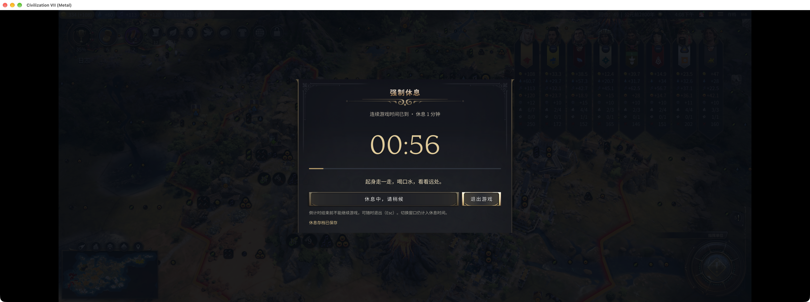
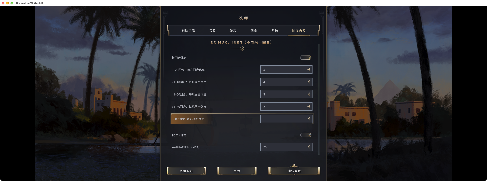
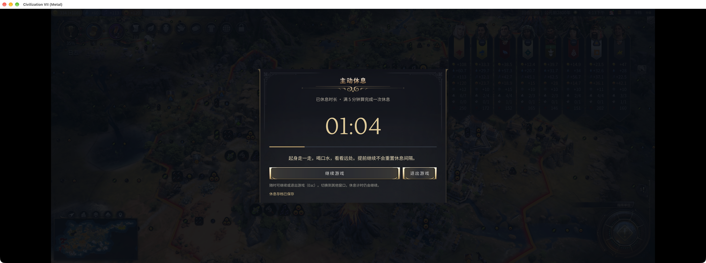
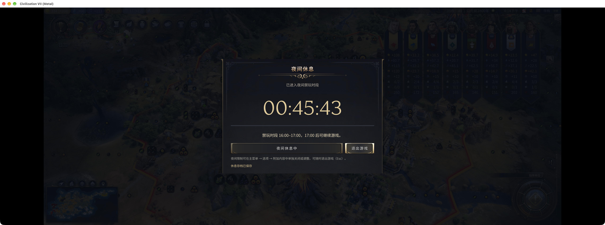
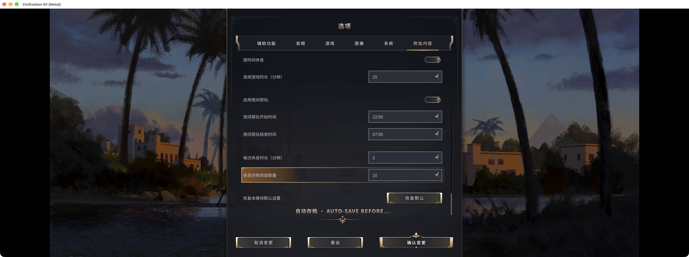
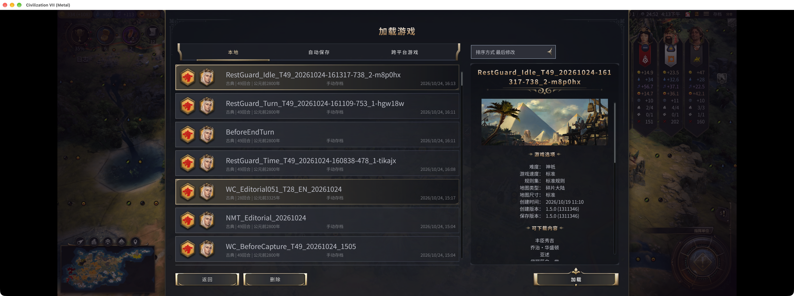

# 《文明7拯救计划》｜不再来一回合

先说结论：这个 Mod 会按游戏时间或回合数让你休息，也可以到晚上直接收工。

文明最难安排的往往不是下一回合干什么，而是哪一回合停下来。奇观还差两回合，研究快好了，部队已经走到门口。每件事都值得再看一下，合在一起就没有结束的时候。

所以我做了「不再来一回合」。既然进游戏之前还记得今天要早睡，那就趁那时候把停下来的时间定好。

## 1. 按时间休息，反向番茄钟

到了后期，一回合能安排的事情越来越多。“再打两回合”听着很克制，实际可能又坐了半个小时。

按时间休息默认是玩 25 分钟、休息 5 分钟。时间到了就进入休息面板，不需要先把这一回合做完。倒计时结束后再继续，起身倒杯水不用等整个帝国都安排妥当。

## 2. 按回合休息

前期五回合可能只是侦察兵多走几步，后期五回合已经够处理几轮生产和一场战争。一直用同一个间隔，很容易前面歇得勤，后面反而坐得久。

回合休息会随对局推进逐步加密：每 20 回合一档，新版默认累计 13、8、5、3、2 次结束回合操作就休息一次，采用反向斐波那契数列。第 81 回合起，默认每 2 回合休息。1.8.6 已采用新默认值，已有配置会保留；恢复默认后应用。下方设置截图来自 1.8.5，仍显示旧值。间隔也可以按自己的游戏节奏调整。

## 3. 主动休息

人已经离开电脑去拿东西了，回来又被要求休息，多少有点冤。

连续空闲 1 分钟后，Mod 会显示主动休息面板，刚才离开的时间也算在内。连续休息满 5 分钟就算完成一次，时间和回合两边一起重新计数。提前回来也可以直接继续，只是刚才累计的游戏时间和回合数还在，不会把短暂停顿当成一次完整休息。

## 4. 禁玩时间，早睡早起

最容易往后拖的，通常是“这一轮结束就睡”。这一轮里还有别人的回合，回来又有新提示，于是下一轮已经开始了。

夜间限制默认按电脑本地时间，从 22:00 到次日 07:00 阻止游戏操作。到点后可以退出游戏，第二天解除限制也不会替你自动过回合。作息不同就先去原生附加内容选项里调整时段，默认时间不必硬套在自己身上。

## 5. 休息前自动存档

本来已经愿意关游戏，临走又要想：刚才到底存没存？再回去检查一圈，容易顺手又安排点别的。

每次休息开始时，Mod 会尝试另存一份休息档，面板会显示保存结果。默认保留最近 10 份，较旧的休息档会在新档保存成功后清理；原版自动存档、快速存档和其他手动档不受这项清理影响。退出前看一眼保存状态，确认成功再走。

## 适用范围

工坊版本为 1.8.6，仅用于单人游戏，支持英文和简体中文。默认夜间限制为 22:00–07:00，启用前请先确认作息设置。休息存档的保留数量跨对局合计，重要节点仍建议另存。

本文场景使用工坊 1.8.5，在 Mac 1.5.0 Metal 实际拍摄；演示时临时缩短的间隔已写在图注里。其他平台和实体手柄未在这次补拍中验证。它只限制游戏内操作，不会锁住整台电脑。

[Steam 创意工坊：不再来一回合](https://steamcommunity.com/sharedfiles/filedetails/?id=3815557333)

这个 Mod 管不了今天该不该开这一局，至少能让开局前说好的“只玩一会儿”，在游戏里有个具体的停点。
