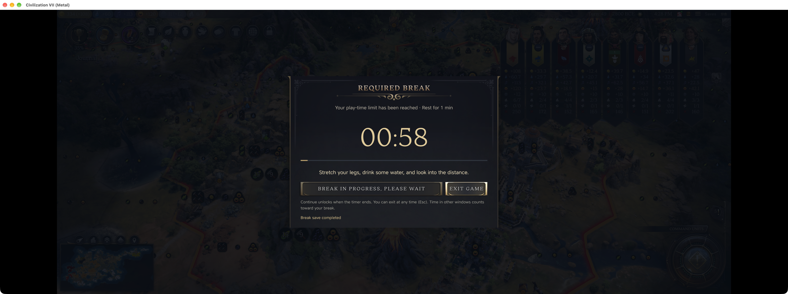
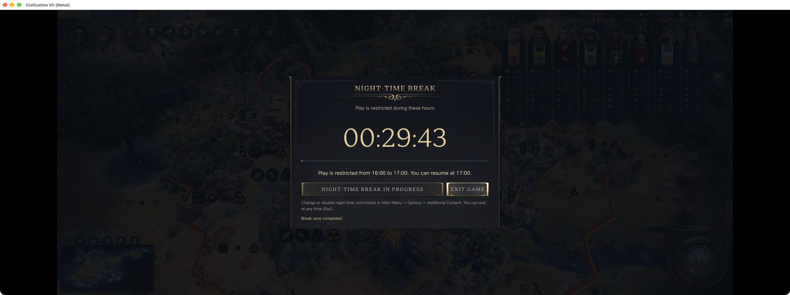
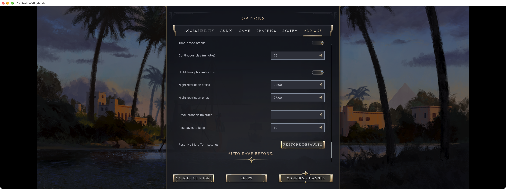
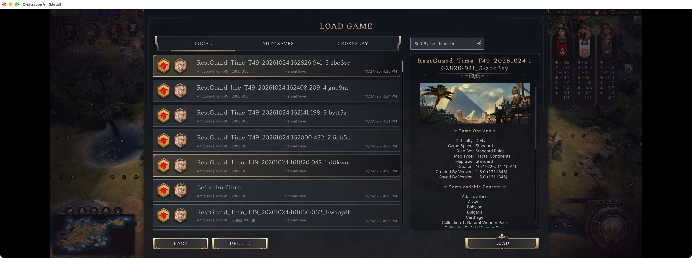

# I made No More Turn: timed breaks and a nightly stopping time for Civ VII

I made a single-player mod for the point where ‘one more turn’ has stopped being a useful promise.

No More Turn offers timed breaks (25 minutes of play, then five minutes away by default), adjustable turn-based breaks, and a nightly restriction. Time spent on a voluntary idle break can count toward the next break, and each break attempts a separate checkpoint.

Please check the night schedule before enabling it: it defaults to 22:00–07:00 local time. Break saves keep the newest ten across campaigns by default; other save types are not cleaned up.

Version 1.8.6 supports English and Simplified Chinese. These images were captured with version 1.8.5 on Mac 1.5.0 Metal, with temporary demonstration timings identified in the captions. Other platforms and physical controllers were not checked in this capture pass. It restricts the game, not the whole computer.

Would you use a clock-based stopping point, or does a turn-based one fit your games better?

[No More Turn on Steam Workshop](https://steamcommunity.com/sharedfiles/filedetails/?id=3815557333)
