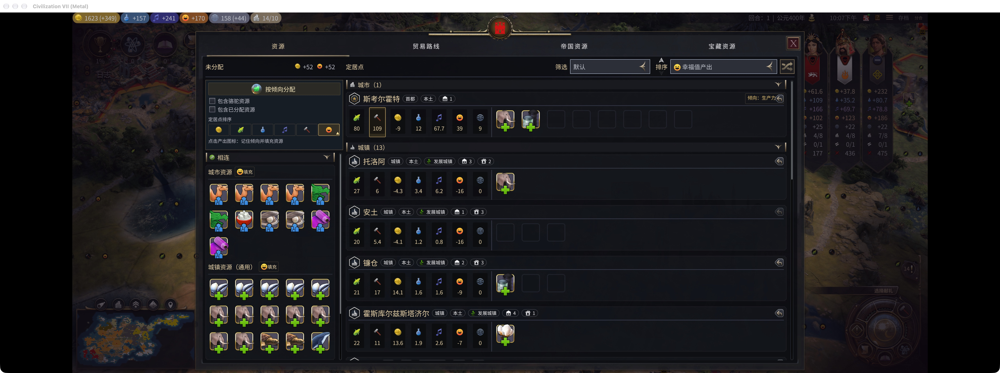
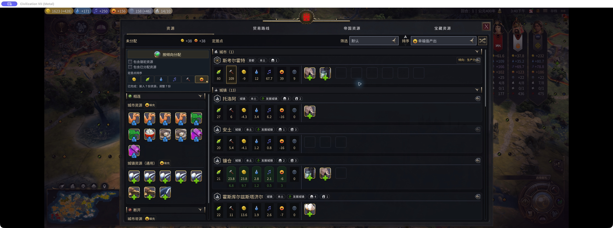
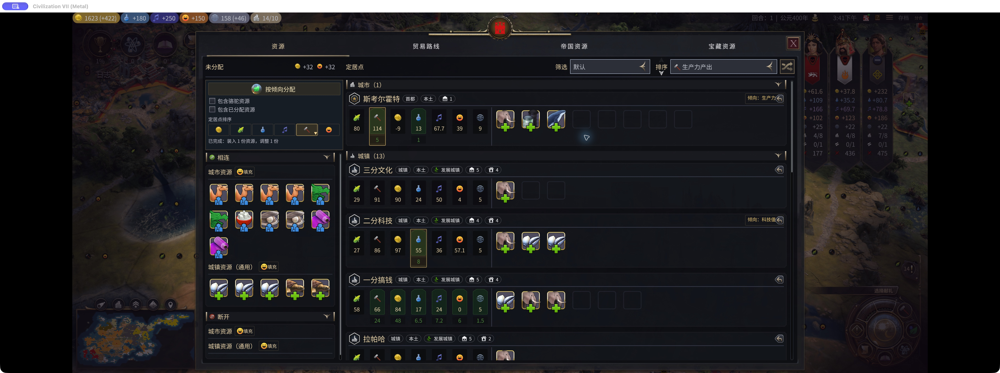

# 《文明7拯救计划》｜资源规划

先说结论：这个 Mod 在资源面板里帮你找缺口、补幸福度，再按各定居点的分工安排资源。需要一起启用 beezany 的 Resource Re-sorts。

资源少的时候，拿到一个就找地方塞；定居点多起来，问题就变成了这份给谁更合适。哪座城缺笑脸，哪座城该堆科研，刚才给出去的资源是不是还有更好的去处，一圈看下来比想象中费劲。

「资源规划」就是把这些判断放回同一个面板里，让分工能记住，也让安排资源少一些来回比较。

## 1. 城市和城镇分组、组内按产出排序

同一张表里既有城市又有城镇，还有没连上贸易网络的地方。往下翻着找一座缺粮的城，很容易把注意力花在辨认列表上。

面板会把城市、城镇和离网定居点分组，再按金币、粮食、科技、文化、生产力或幸福度排序。想看哪里最缺笑脸，就按幸福度找；想给科研城加码，就按科研看。不需要的组也可以折起来。

## 2. 幸福度优先补到0以上

有的城还在负幸福度，有的城已经不缺了。要是只看哪里还有空槽，很容易这边堆过头，那边仍然红着。

幸福度填充会优先补负值，达到非负后不再继续堆纯幸福度资源。城市资源旁的填充先照顾城市，再处理城镇；只想处理城镇时，也有对应入口，不必重新动已经安排好的城市。资源不够、槽位不够的时候，缺口不会凭空消失。

## 3. 标记城市倾向，一键安排新资源

几座城都能放同一份资源，不代表放在哪里都一样。科研城和生产城的需求不同，一直按列表从上往下塞，后面真正需要的地方可能就轮不到。

点击定居点的产出图标，可以记下它的倾向并尝试分配相关资源。“按倾向分配”会一起比较已设倾向的定居点、收益和容量，不只是让排在前面的城先拿。

默认保留已有安排；要重新调配，可以把已分配资源纳入。如果允许使用骆驼，也会考虑多出来的槽位能带来多少收益。定好分工以后，下次回来不用再逐城从头想一遍。

## 4. 配合垃圾时间 mod，新资源自动插入

科研城、生产城的倾向已经标好，新资源开放分配后，也可以省掉再打开面板点一次。

同时启用「垃圾时间」，在“选项 → 附加内容”里打开“资源分配垃圾时间”，就会在每个己方回合按记住的城市倾向自动安排一次。默认只使用空闲资源；原版锁定分配时会等待解锁。需要同时启用资源规划和 Resource Re-sorts。

这次实机中，资源面板关闭时自动插入了8份资源，首都生产力从109升至129，二分科技科研从47升至55。

## 适用范围

工坊版本为 1.1.0，必须安装并启用 Resource Re-sorts。界面支持英文和简体中文；原来的资源／贸易入口就能打开。倾向可跨重启和读档保留，同一地图的旧档共用这些界面偏好。

分配遵守原版资源锁定、贸易网络、资源类别和槽位规则，不保证所有组合都是全局最优。2026-10-23 至 24 日在 Mac 1.5.0 Metal 上验证过中英文界面、鼠标资源操作、幸福度填充、倾向分配与排序，实体手柄、多人和全部第三方组合尚未完整验证。

[Steam 创意工坊：资源规划](https://steamcommunity.com/sharedfiles/filedetails/?id=3822254182)

[必需依赖：Resource Re-sorts](https://steamcommunity.com/sharedfiles/filedetails/?id=3507102808)

资源不会因此多出一份，但可以少在面板里搬来搬去，把已有的东西安排得更贴近这一局的打法。
