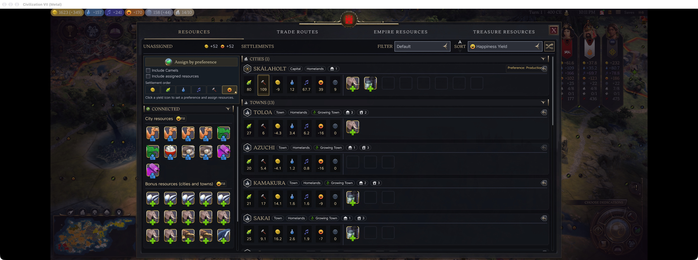
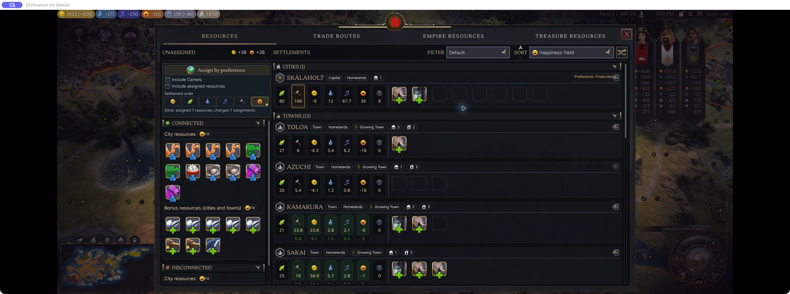
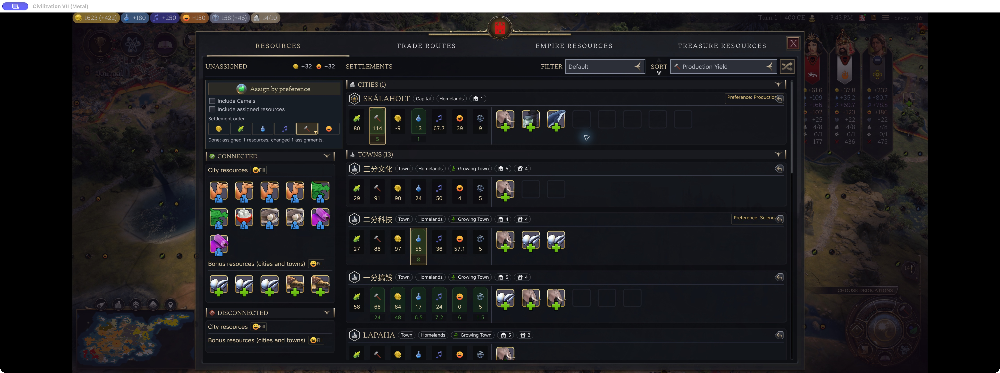

# Resource Planner 1.1.0: happiness filling and remembered settlement roles in Civ VII

I'm the author of Resource Planner, an extension for beezany's Resource Re-sorts. It requires that mod to be enabled.

The main additions are grouped/sortable settlements, Fill for negative happiness, and remembered yield preferences with allocation across settlements. Existing allocations stay in place by default; you can include them or camels when you want a broader rearrangement.

Pair it with Garbage Time to apply remembered priorities automatically once per eligible local-player turn, using unassigned resources by default.

Version 1.1.0 supports English and Simplified Chinese. Mac 1.5.0 Metal checks covered language display, mouse resource interaction, happiness filling and preference assignment. Physical-controller and multiplayer acceptance are incomplete.

The game still enforces trade connections, capacity and resource locks. This is not a guarantee of globally optimal allocation, and other mods replacing the same resource page may conflict.

If you try it, which settlement/resource combinations are hardest to plan around?

[Resource Planner on Steam Workshop](https://steamcommunity.com/sharedfiles/filedetails/?id=3822254182)

[Required: Resource Re-sorts](https://steamcommunity.com/sharedfiles/filedetails/?id=3507102808)
