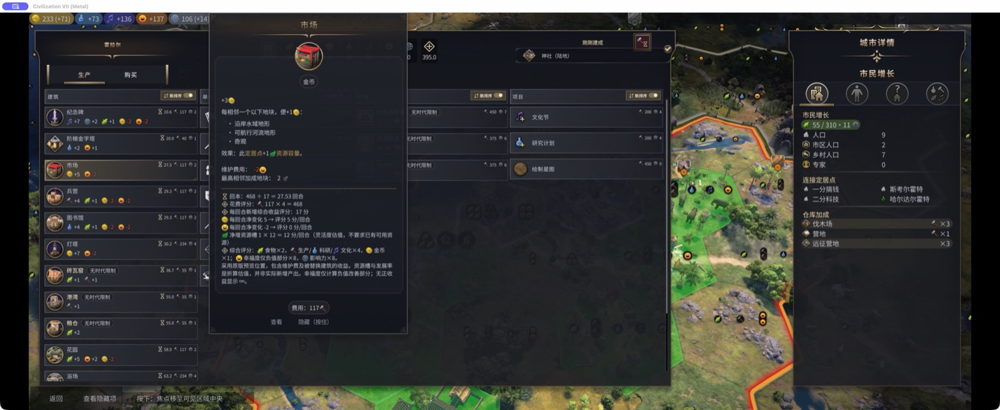
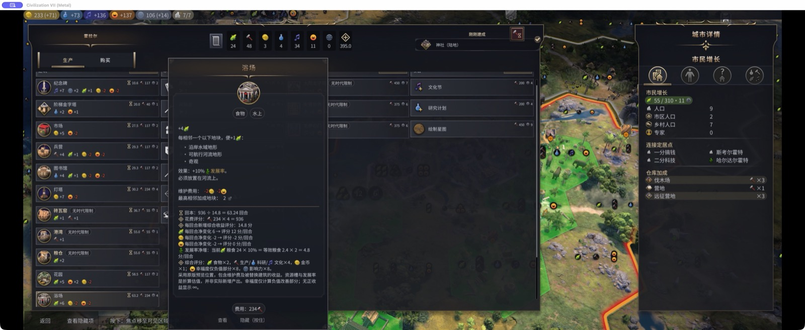
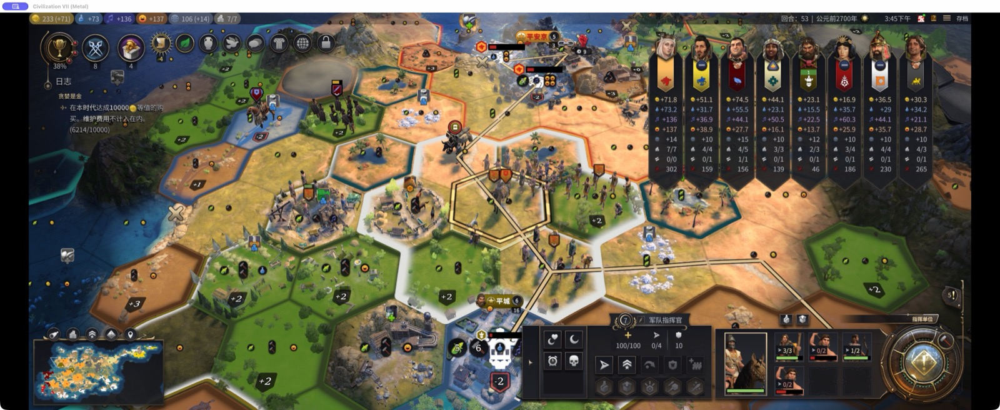
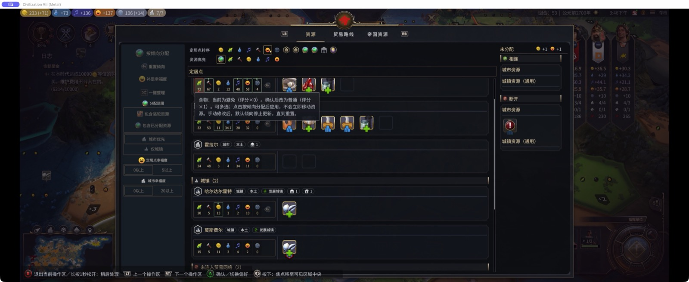
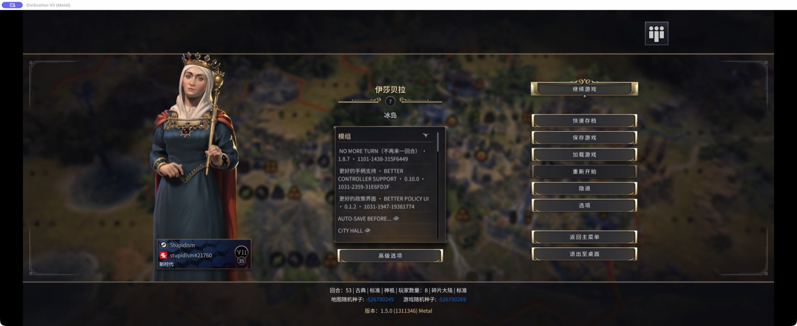
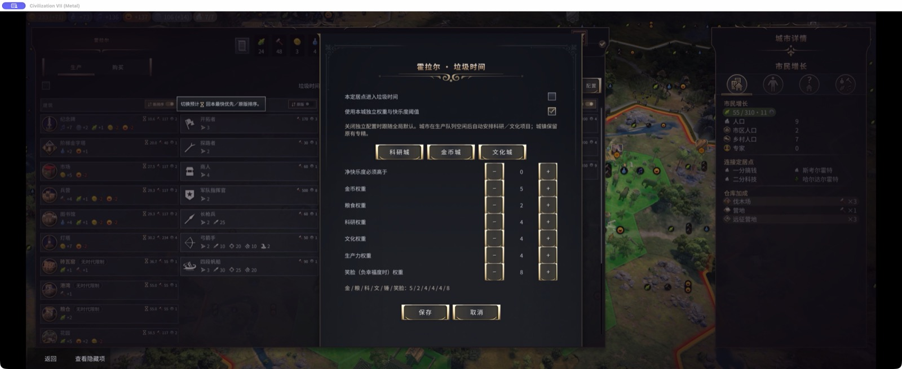
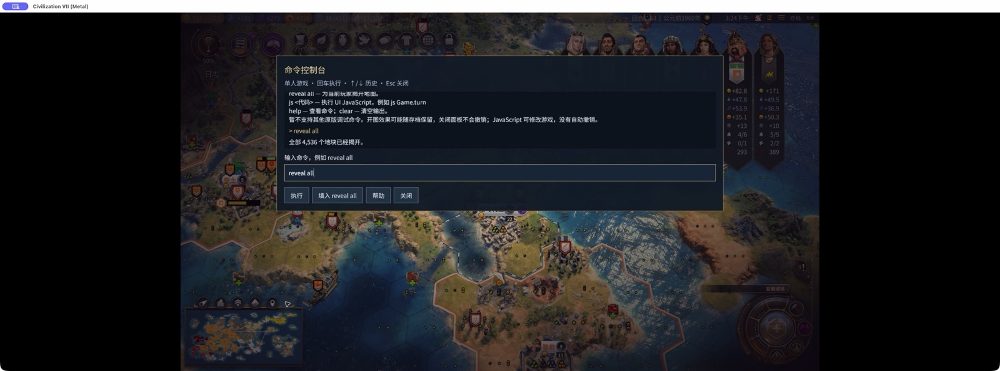

# 文明 VII — 版本与验收证据

快照：2026-11-01（UTC+08:00）。用户已更正此前笔误：验收记录使用中文。游戏原始截图、机器输出、标识符和复现字符串保持原样。

[当前版本与验收看板](https://github.com/users/Stupidism/projects/5)

发布状态说明：最近一次有记录的微操大师发布尝试已中断，没有新发布完成回执，公开版本仍为 0.6.1。

通知策略：用户确认「你的神图很好，现在是我的了」（civ7-play-again）开发已长期停滞，暂不通知、催办或唤醒其会话。保留既有版本、Bug 和测试证据；本次中文更正没有通知该会话。

## 阅读说明

- 公开版本、开发版本、已安装构建和实际测试构建分别记录。版本号相同不代表文件相同。
- 限定范围的测试通过不等于全面验收；离线检查、原生游戏 API／输入事件及实体输入分别说明。
- Bug 的影响版本只列已确认构建。未知旧版本不标为受影响，也不标为不受影响。
- 以下截图均为真实界面。历史截图明确标注，不验证新构建；缺少截图时如实记录。
- 本快照仅维护跟踪记录，没有发布 Mod 包，也不授予新的游戏测试权限。

## 2026-11-01 统合测试

环境为 macOS ARM64、文明 VII 1.5.0（1311346）Metal、中文界面，游戏视口 2560 × 1080。使用原 T53 快速存档的隔离副本，没有推进回合。测试采用游戏 UI／API 及原生输入事件，没有连接实体手柄。

### 离线检查

| 测试组 | 通过 | 失败 | 范围 |
| --- | ---: | ---: | --- |
| 更好的定居点界面 | 65 | 0 | 已配置浏览器依赖，无跳过项 |
| AO／政策界面／BCS／微操大师／资源规划／不再来一回合 | 823 | 0 | 最初跳过一项字体测试 |
| 原生字体补测 | 1 | 0 | 使用实际游戏字体和 Chromium 重跑上述跳过项 |
| 垃圾时间 | 74 | 0 | 源码测试 |
| 去重后的通过总数 | **963** | **0** | 不是 963 项实机测试，也不是每个 Mod 各有 963 项 |

### 存档保护与收尾

全部游戏／控制进程已退出并等待结束。原始 Saves 基线包含 422 个文件、6 个目录，已逐项核对路径、大小和 SHA-256。只有手动保存测试改变了原快速存档，已从验证后的压缩基线恢复；其他未改变的原文件没有重写。测试专用副本已移除。原 Mod 开关（含 null／默认值）、modSettings 和选项文件均已恢复。垃圾时间临时替换的两个运行文件已恢复，已安装文件基线哈希核对通过。恢复成功后立即删除了全部四个压缩恢复包，没有保留额外整目录副本或永久的最终备份。游戏锁已释放。

### 详细观测值

- 定居点界面：城市 196610 的食物为 24。市场 `(117×4)/(5 金币 + 12 槽位价值)=27.53` 回合；灯塔 `(234×4)/(7 金币 + 24 槽位价值)=30.19`；浴场 `(234×4)/(6 食物×2 − 2 金币 + 24×10%×2)=63.24`；纪念碑 `(117×4)/(7 文化×4 + 1 食物×2 − 2 金币 + 2 影响力×8)=10.64`。原生条目、评分输出与 ProductionTooltip 一致。未执行购买、完工、覆盖建造或修复。
- 微操大师：指挥官 196609、军队 65536；真实单位移动力为 3/3、1/2 及两个 0/2。检查了红色零值、空槽位和生命条。
- 资源规划／AO／BCS：恰好一个 ResourceDefer 控件，没有 AO／旧 BCS 跳过控件；暂缓操作关闭页面并设置 deferred。退出前七座城市的生产队列和资源均未改变。Cohtml 伪元素计算样式不作为可靠几何证据；标记位置由截图和已安装 CSS 支持。
- 政策界面：16 张卡牌、8 个槽位，约宽 184.21px、高 168px；120 个动画帧只有一种布局。左侧分组为 2+2 列，右侧分组为 4 列；槽位已满时跳过控件数量正确为零。
- 神图：C7S2 导出 73 个字段；修改种子与 NoCivUnlocks 后接受 74 个字段，多出的字段为玩家数量。未创建新世界。
- 不再来一回合：临时仅启用时间限制，游戏／休息各一分钟，无调试豁免，suspended=false。自然强制休息后全部 423 个文件不变。原生快速存档在超时后及剩余 56.298 秒时均成功。返回时遮罩恢复，剩余 38.664 秒，截止时间不变。继续后仍为 T53、turnComplete=false。重复 SaveComplete 日志来自重复观测钩子，不能据此认为保存多次。第二次自然强制休息前关闭过一次空闲面板；输入事件避免空闲，没有修改计时器。
- 垃圾时间：仅临时安装 city-panel.js 和 resource-model.js，全部自动化开关保持关闭。原生 accept 可打开配置、应用金币预设、将金币权重 4→5 后保存。真实资源桥返回无变更且 error=false，七座城市的分配均未改变。

## civ7-better-settlement-ui

**更好的定居点界面**（Better Settlement UI）

- 公开版本：未发布
- 开发版本：0.1.10
- 发布状态：未发布；测试状态：部分实机验证
- 证据核对日期：2026-11-01

### 已验证范围

- 65 项离线检查通过。
- T53 市场、灯塔、浴场和纪念碑的评分与原生提示内容符合真实城市数据。资源槽位按每回合 12 点计值，影响力权重为 8。
- 生产／购买模式切换和金币不足时禁用购买的检查通过。

### 待验收范围

- 实际购买、完工、覆盖建造和修复。
- 实体手柄输入。

### 已记录缺陷

- 经核对的证据中尚未记录未解决缺陷；这不代表没有 Bug。

### 截图

2026-11-01 统合测试截图，范围仅限上文构建。

2026-11-01 统合测试截图，范围仅限上文构建。

## civ7-war-controls

**微操大师**（Micromanagement Master）

- 公开版本：0.6.1 — [工坊页面](https://steamcommunity.com/sharedfiles/filedetails/?id=3822253543)
- 开发版本：0.6.1 + 发布后修复
- 发布状态：未发布；测试状态：部分实机验证
- 证据核对日期：2026-11-01

### 已验证范围

- T53 的 3/3、1/2、0/2 徽标与原生移动力一致；零移动力为红色，空槽位不显示徽标，生命条保持可见。
- 此前 T44 快速转移和 LB/RB 的结果保留原有验证范围。

### 待验收范围

- T53 本轮没有重复验证移动、攻击、快速转移或实体手柄。
- 虽已收到发布请求，但最近一次有记录的发布尝试已中断，尚无完成回执；公开版本仍为 0.6.1。

### 已记录缺陷

- 经核对的证据中尚未记录未解决缺陷；这不代表没有 Bug。

### 截图

2026-11-01 统合测试截图，范围仅限上文构建。

## civ7-resource-planner

**资源规划**（Resource Planner）

- 公开版本：1.1.0 — [工坊页面](https://steamcommunity.com/sharedfiles/filedetails/?id=3822254182)
- 开发版本：1.3.1
- 发布状态：未发布；测试状态：部分实机验证
- 证据核对日期：2026-11-01

### 已验证范围

- 已安装的三角标记居中 CSS 与源码一致，红色负值和绿色正值标记均位于边缘内侧的居中位置。
- 原生焦点／输入可以修改偏好。仅存在一个暂缓控件；触发后关闭界面并设置 deferred。
- 与垃圾时间联调时返回无变更且 error=false，七座城市均保留原资源分配。

### 待验收范围

- 实际资源重新分配／COMPLETED 路径、失败回滚和实体手柄。

### 已记录缺陷

- 经核对的证据中尚未记录未解决缺陷；这不代表没有 Bug。

### 截图

2026-11-01 统合测试截图，范围仅限上文构建。

## civ7-rest-guard

**不再来一回合**（No More Turn）

- 公开版本：1.8.7 — [工坊页面](https://steamcommunity.com/sharedfiles/filedetails/?id=3815557333)
- 开发版本：1.8.7-dev.1101-1438-315f6449
- 发布状态：未发布；测试状态：部分实机验证
- 证据核对日期：2026-11-01

### 已验证范围

- 在没有调试豁免的情况下自然触发一分钟强制休息，全部 423 个存档文件保持不变。
- 剩余 56.298 秒以及截止时间之后，原生快速存档均成功；返回时遮罩恢复，截止时间没有重置。
- 继续按钮没有提交回合。原设置与快速存档均已恢复。

### 待验收范围

- 本轮未重测夜间限制、回合阈值、退出确认和实体手柄。
- 公开版 1.8.7 仍为旧行为；开发构建采用不同实现。

### 已记录缺陷

- 经核对的证据中尚未记录未解决缺陷；这不代表没有 Bug。

### 截图

2026-11-01 统合测试截图，范围仅限上文构建。

2026-11-01 统合测试截图，范围仅限上文构建。

## civ7-garbage-time

**垃圾时间**（Garbage Time）

- 公开版本：0.1.4 — [工坊页面](https://steamcommunity.com/sharedfiles/filedetails/?id=3822254009)
- 开发版本：0.1.4 + 未发布的界面／资源补丁
- 发布状态：未发布；测试状态：待复测
- 证据核对日期：2026-11-01

### 已验证范围

- 74 项离线检查通过。原生 accept START/FINISH 可打开城市配置、将金币权重从 4 改为 5、保存并关闭页面。
- 实际资源桥接返回无变更且 error=false，七座城市的分配均未改变。测试后已恢复临时安装的两个文件。

### 待验收范围

- IT-02：手柄按键提示仍被隐藏。
- 实际资源重新分配、回滚、不提供 statusCode 的旧资源规划版本，以及实体手柄。

### 已记录缺陷

- **IT-02**（未解决）：【垃圾时间】添加 action-key 后手柄按键提示仍被隐藏。已确认影响：0.1.4 + 未发布 city-panel.js 补丁；SHA256 469c1b7e1ea87021d5866da2becbf41438807d8777864b0f0509961ec9fd2369。修复版本：尚未修复。测试后已恢复公开版 0.1.4；本回执不能证明所有旧版均受影响。

### 截图

2026-11-01 统合测试截图，范围仅限上文构建。

## civ7-play-again

**你的神图很好，现在是我的了**（Play Again / Your Great Map）

- 公开版本：未发布
- 开发版本：0.4.0-dev（已安装）；0.3.6-dev（主目录源码）
- 发布状态：已暂停；测试状态：待复测
- 证据核对日期：2026-11-01
- 通知策略：开发长期停滞，暂不通知；等待用户明确恢复通知。

### 已验证范围

- C7S2 导出 73 个字段；预览和应用成功，接受 74 个字段、跳过 0 个；新增字段为玩家数量。
- 真实 GameSetup 中的两个种子及 NoCivUnlocks 已改变。未创建新世界。

### 待验收范围

- IT-01：队伍与难度显示原始本地化键。
- 实体剪贴板粘贴、替换非空纪念物、非法玩家列表、历史存档导入和新世界生成。
- 不得用主目录源码覆盖更新的已安装构建。
- 用户确认开发已长期停滞，暂不通知、催办或唤醒开发会话；保留既有 Bug 与验收缺口，等待用户明确恢复通知。

### 已记录缺陷

- **IT-01**（未解决）：【神图】队伍与难度标签显示原始本地化键。已确认影响：0.4.0-dev 已安装构建（2026-11-01）。修复版本：尚未修复。未验证 0.3.6-dev 及更早构建是否存在此缺陷。

### 截图

2026-11-01 统合测试截图，范围仅限上文构建。

2026-11-01 统合测试截图，范围仅限上文构建。

## civ7-better-policy-ui

**更好的政策界面**（Better Policy UI）

- 公开版本：未发布
- 开发版本：0.1.2-dev.1031-1947-19381774
- 发布状态：未发布；测试状态：部分实机验证
- 证据核对日期：2026-11-01

### 已验证范围

- T53 有 16 张卡牌和 8 个槽位；连续 120 个动画帧布局完全一致。
- 槽位已满时正确地不显示跳过控件。此前对已安装 0.1.2 进程的检查确认，带 LF 预览时几何布局稳定。

### 待验收范围

- 最新组合没有重测空槽位草稿、确认、强制结束回合和实体手柄。
- 这些证据不覆盖其他分辨率及全部 Mod 组合。

### 已记录缺陷

- **BPU-01**（已修复）：【政策界面】异步布局更新期间保持卡牌几何尺寸。已确认影响：0.1.0 / build 1031-1501-38d835f3。修复版本：0.1.1；0.1.2 也已验证。不推断更广的受影响范围。
- **BPU-02**（已修复）：【政策界面】修正 Gameface 槽位高度与 rem 尺寸换算。已确认影响：0.1.1 / build 1031-1601-c3456a23。修复版本：0.1.2。不推断更广的受影响范围。

### 截图

2026-11-01 统合测试截图，范围仅限上文构建。

## civ7-action-order

**行动顺序调整**（Action Order Adjustments）

- 公开版本：未发布
- 开发版本：0.1.0
- 发布状态：未发布；测试状态：部分实机验证
- 证据核对日期：2026-11-01

### 已验证范围

- 已安装运行代码与源码一致，共享服务及生产／卡牌提供器均存在。
- 唯一暂缓控件归资源规划所有，未出现重复的 AO／旧 BCS 控件。七座城市均保留原队列和资源。
- 此前 T38→T39 的实际保存／单次提交证据保留独立验证范围。

### 待验收范围

- 本轮未重测完整三阶段顺序、空草稿及实体手柄。

### 已记录缺陷

- 经核对的证据中尚未记录未解决缺陷；这不代表没有 Bug。

### 截图

2026-11-01 统合测试截图，范围仅限上文构建。

## civ7-map-tools-gamepad

**更好的手柄支持**（Better Controller Support）

- 公开版本：0.3.0 — [工坊页面](https://steamcommunity.com/sharedfiles/filedetails/?id=3825193325)
- 开发版本：0.10.0-dev.1031-2359-31e6fd3f
- 发布状态：未发布；测试状态：部分实机验证
- 证据核对日期：2026-11-01

### 已验证范围

- BSU／政策界面／AO／资源规划组合的截图和原生输入路径通过已记录的检查。
- 资源暂缓控件恰好一个；政策界面连续 120 帧几何布局稳定。

### 待验收范围

- 本轮未新增实体摇杆／按键验收；此前通过验收的摇杆代码未改变。
- 组合中的 IT-02 属于垃圾时间，不能自动归因于 BCS。

### 已记录缺陷

- 经核对的证据中尚未记录未解决缺陷；这不代表没有 Bug。

### 截图

2026-11-01 统合测试截图，范围仅限上文构建。

2026-11-01 统合测试截图，范围仅限上文构建。

2026-11-01 统合测试截图，范围仅限上文构建。

## civ7-better-chinese-support

**更好的中文支持**（Better Chinese Support）

- 公开版本：0.2.2 — [工坊页面](https://steamcommunity.com/sharedfiles/filedetails/?id=3829402170)
- 开发版本：0.2.2（发布工作树）；主目录源码 0.2.1
- 发布状态：已发布；测试状态：仅离线检查
- 证据核对日期：2026-11-01

### 已验证范围

- 10 项离线检查通过。下载的七个发布文件与发布清单一致。
- 0.2.2 明确将神权制购买加成的对象写为神庙和传教士。

### 待验收范围

- 0.2.2 新文案尚未进行游戏内检查。旧版 0.2.1 截图不能验证新措辞。

### 已记录缺陷

- 经核对的证据中尚未记录未解决缺陷；这不代表没有 Bug。

### 截图

暂无当前开发构建的已验证截图。

## civ7-before-end-turn

**行动前自动存档**（Auto-save Before...）

- 公开版本：1.1.2 — [工坊页面](https://steamcommunity.com/sharedfiles/filedetails/?id=3815596737)
- 开发版本：公开版 1.1.2；主目录源码 1.1.1 + 修复
- 发布状态：已发布；测试状态：部分实机验证
- 证据核对日期：2026-11-01

### 已验证范围

- 已安装工坊 1.1.2；负责人已移除重复的手动副本。
- 保留此前 T38 的 save-start／save-complete／单次提交及随后进入 T39 的证据。

### 待验收范围

- 仍需核对主目录源码与发布版本的对应关系；最新统合测试没有重跑存档链路。

### 已记录缺陷

- 经核对的证据中尚未记录未解决缺陷；这不代表没有 Bug。

### 截图

暂无当前开发构建的已验证截图。

## civ7-command-console

**命令控制台**（Command Console）

- 公开版本：未发布
- 开发版本：0.1.0
- 发布状态：未发布；测试状态：部分实机验证
- 证据核对日期：2026-10-28

### 已验证范围

- 18 项离线检查及原生 macOS 自动输入检查：js Game.turn 返回 83；reveal all 将已发现地块从 2912 增至 4536/4536。
- ABC／英文输入下的退格、历史命令和 Escape 检查通过。

### 待验收范围

- 最后修复后的最终安装副本未进行冷启动。中文输入法、剪贴板、实体键盘／手柄尚未验收。

### 已记录缺陷

- 经核对的证据中尚未记录未解决缺陷；这不代表没有 Bug。

### 截图

历史界面截图，不代表新一轮验收；启动器画面不单独证明命令执行结果。

## fenhe

**分合（两模块合计）**（Fenhe (gameplay + UI)）

- 公开版本：暂无发布证据
- 开发版本：0.2.0-alpha + 手柄界面
- 发布状态：未发布；测试状态：待实机测试
- 证据核对日期：2026-10-30

### 已验证范围

- 历史记录包含 36 项离线检查；一局 Mac 世界的探索时代集成、保存和重新加载路径通过。

### 待验收范围

- 新手柄界面、英文覆盖、多地图／DLC／时代及本地适配器分发。

### 已记录缺陷

- 经核对的证据中尚未记录未解决缺陷；这不代表没有 Bug。

### 截图

暂无当前开发构建的已验证截图。

## civ7-autosave-limit

**自动存档上限150**（Autosave Limit 150）

- 公开版本：暂无发布证据
- 开发版本：1.0.0
- 发布状态：未发布；测试状态：待实机测试
- 证据核对日期：2026-10-30

### 已验证范围

- 归档记录描述 Mac 原生滑块可在 1～150 间调整。本轮未独立复测。

### 待验收范围

- 缺少对应具体版本的验收证据与双语元数据；没有工坊发布回执。

### 已记录缺陷

- 经核对的证据中尚未记录未解决缺陷；这不代表没有 Bug。

### 截图

暂无当前开发构建的已验证截图。

## civ7-native-debug-input

**Mac DebugPanel 输入修复（启动器）**（Mac DebugPanel Input Fix (public launcher)）

- 公开版本：0.2.0 — [工坊页面](https://steamcommunity.com/sharedfiles/filedetails/?id=3829280398)
- 开发版本：0.2.0 公开启动器
- 发布状态：已发布；测试状态：部分实机验证
- 证据核对日期：2026-10-29

### 已验证范围

- Apple Silicon／Steam 文明 VII 1.5.0：已检查 Finder 解压和工坊下载两条启动器路径。
- 原生 DebugPanel 的 reveal all 将已发现地块从 2912 增至 4536。

### 待验收范围

- QA-EXIT-11：退出崩溃仍未解决；安装前已有类似堆栈，尚不能确认因果关系。
- 未验收其他游戏版本、Intel 或中文输入法；内部 native-input 0.4.0-dev 不等于此公开启动器版本。

### 已记录缺陷

- **QA-EXIT-11**（未解决）：【macOS 启动器】排查尚未解决的退出崩溃／退出码 11。已确认影响：Better Mod Support 0.2.0-dev；公开 Mac DebugPanel 启动器 0.2.0 的测试环境。修复版本：尚未修复。根因及回归边界未知；安装 native-input 之前已有类似退出堆栈。

### 截图

历史界面截图，不代表新一轮验收；启动器画面不单独证明命令执行结果。

## civ7-mac-launcher

**更好的Mod支持（Better Mod Support）**（Better Mod Support）

- 公开版本：未发布
- 开发版本：0.2.0-dev
- 发布状态：未发布；测试状态：待复测
- 证据核对日期：2026-10-30

### 已验证范围

- 历史检查覆盖增强 Mod 注册／持久化、原生 reveal all 和神图存档 834 导入。
- 已有记录报告 155 项 Node 检查及三项原生程序检查；对应草稿 PR #6。

### 待验收范围

- QA-EXIT-11：退出码 11 尚未解决。
- 干净机器发布、Intel、实体手柄和输入法尚待验收；仍依赖 Cohtml 调试桥。

### 已记录缺陷

- **QA-EXIT-11**（未解决）：【macOS 启动器】排查尚未解决的退出崩溃／退出码 11。已确认影响：Better Mod Support 0.2.0-dev；公开 Mac DebugPanel 启动器 0.2.0 的测试环境。修复版本：尚未修复。根因及回归边界未知；安装 native-input 之前已有类似退出堆栈。

### 截图

历史界面截图，不代表新一轮验收；启动器画面不单独证明命令执行结果。

## civ7-controller-bridge

**Mac 手柄支持修复**（Mac Controller Support Fix (retired)）

- 公开版本：0.1.5（不公开列出） — [工坊页面](https://steamcommunity.com/sharedfiles/filedetails/?id=3825119575)
- 开发版本：已退役；并入 BCS
- 发布状态：已退役；测试状态：不适用
- 证据核对日期：2026-10-24

### 已验证范围

- 退役回执记录为不公开列出，独立代码已移除。

### 待验收范围

- 不再作为活跃开发／发布目标。

### 已记录缺陷

- 经核对的证据中尚未记录未解决缺陷；这不代表没有 Bug。

### 截图

暂无当前开发构建的已验证截图。

## civ7-assistant

**文明7小助手（辅助应用）**（Civ VII Assistant (auxiliary app)）

- 公开版本：未发布
- 开发版本：0.1.0 项目骨架
- 发布状态：已暂停；测试状态：未测试
- 证据核对日期：2026-10-30

### 已验证范围

- 尚无可运行交付物的验收记录。

### 待验收范围

- 作为备用方案已暂停，没有可运行的验收交付物。

### 已记录缺陷

- 经核对的证据中尚未记录未解决缺陷；这不代表没有 Bug。

### 截图

暂无当前开发构建的已验证截图。

## 证据文件

选定的机器观测位于 [evidence/](evidence/)。仅供本机恢复使用的清单与会话回执仍保留在统合工作目录，未上传。

## 来源与责任

本快照核对了统合测试、负责人验收文档及 2026-11-01 18:05 盘点。负责会话引用仅保存在私有 Project。建立看板及中文更正均未修改主分支运行代码。
