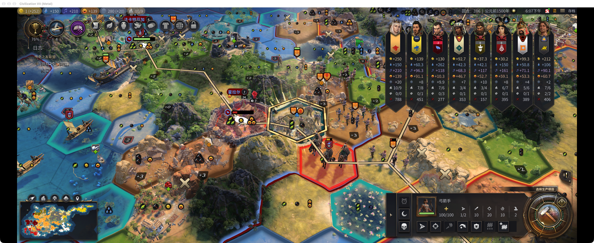
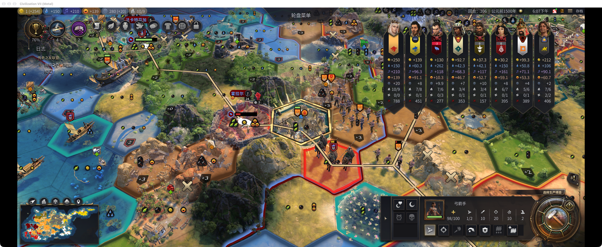

# 微操大师：商人占格快速转移脚本验收

2026-11-05（澳大利亚悉尼）。任务 WAR-08，发布基线 0.6.3，实测开发构建 `0.6.3-dev.1102-2206-21d296ec`。运行文件哈希见 build.json；未改动或发布生产代码。

**结论：部分验收。** 己方商人占格的鼠标地图路径、地图焦点手柄确认路径均通过，并从干净隔离存档完整重跑成功。外方商人尚未完成实机验证；脚本注入不是实体手柄或操作系统鼠标硬件验收。

| 检查 | 结果 | 证据 |
|---|---|---|
| 快速转移离线自动化 | 59 通过，0 失败、0 跳过 | offline-final.log |
| 己方商人格鼠标地图选择 | 通过 | mouse.json |
| 己方商人格手柄原生输入、地图焦点 | 通过 | controller.json |
| 从固定隔离存档重新准备场景并重跑两条路径 | 通过 | scene.json、suite.json |
| 外方商人占格实机 | 未测试，尚无满足前置条件的场景 | 不以离线模拟替代 |
| 实体手柄、操作系统鼠标输入 | 本轮脚本范围外 | 不使用 Computer Use |

## 实际断言

两条路径各自发送恰好一次 `UNITCOMMAND_ADD_TO_ARMY` 和一次 `UNITCOMMAND_REMOVE_FROM_ARMY`，收到原生加入/移出事件；单位到达 `(17,22)`、脱离军队，移动力 2→1。指挥官仍在 `(17,23)`，移动力保持 4。商人仍在原格，没有被替换或移动。正式操作没有 MOVE_TO 等行走命令。

使用 T106、seed `-526700269` 的隔离副本。脚本通过原生购买生成商人并沿原生路径移动至目标。仅场景准备阶段补足购买金币和恢复商人移动力；正式测试不补移动力、不替换许可、不伪造完成事件。两条路径之间用原生加入指令收回第一名测试兵，为第二名测试兵腾出目标格。

## 可重复执行

本地仓库入口：`mods/civ7-war-controls/tests/live/run-merchant-suite.mjs`。

- [运行与恢复说明](商人占格测试.md)
- [自动场景准备](prepare-merchant-fixture.mjs)
- [原生操作与断言](quick-transfer-civilian.mjs)
- [串联入口](run-merchant-suite.mjs)

脚本附件在仓库对应 tests/live 位置运行，依赖仓库既有 CDP、游戏锁、活动标记和截图辅助脚本；私有存档不分发。每次重新加载前仍须完成本轮完整 Saves 备份并核验。单纯重新执行脚本不授予游戏控制权限。

## 调查结果及开发会话核对

有可攻击目标的弓箭手按现有规则优先攻击，不应当作快速转移测试源。脚本已增加这一前置检查。

手柄确认键落在单位面板“移动”按钮时会启动原生移动；开发会话已离线确认这符合“保留原生面板焦点”的设计，不是本次占格功能缺陷。测试入口显式建立地图焦点、校验光标后再发送确认键，不能据此宣称自动焦点或实体设备通过。未确认生产代码 Bug，无需开发修复；相关观察已反馈负责会话。

## 中文截图

## 恢复回执

游戏已退出，全部子脚本结束。479 个原存档文件及 6 个目录逐项核验一致，移除 2 个隔离副本，Rest Guard 和设置恢复，3 份本轮恢复压缩包已在验证成功后删除，游戏锁已归还。见 restoration.json。
