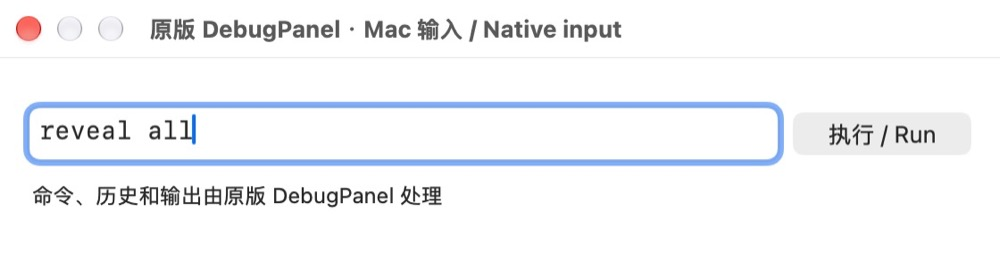
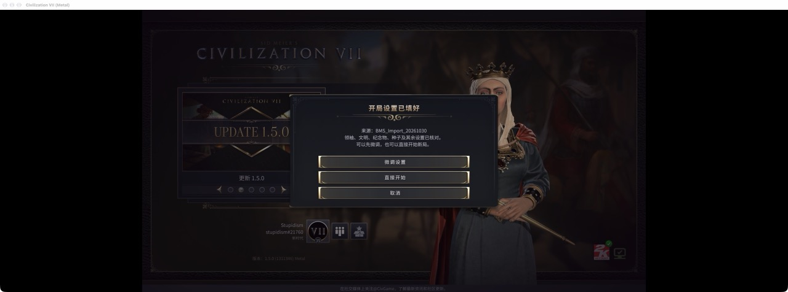
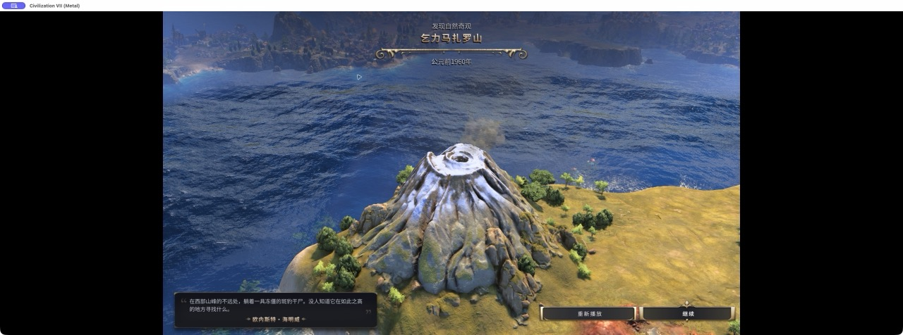

# Better Mod Support — Mac live acceptance, 2026-10-30

Tested commit: `dd04736` (subsequent commit adds this evidence only). Apple Silicon, macOS 27.0.1, Steam Civilization VII 1.5.0 (1311346). Package: shared launcher 0.1.0-dev with Native Debug Input and Play Again 0.3.7-dev. ZIP SHA-256: `03b81aa06c851439c43aef29c559b7d973d1c36b9d853b830131c9b60fa98d31`.

The host game lock was held throughout installation, Steam configuration, game interaction and restoration. Every launch/load/import round had a complete verified Saves backup. Rest Guard's two installed script entry points were temporarily disabled and its runtime was verified inactive. Tests used named copies; all 401 original save files retained their exact hashes. Four test files were archived outside the game at completion. Installed mods, Rest Guard, Fenhe, both changed settings databases and the original Steam launch option were restored before releasing the lock. No Workshop publication or merge occurred.

## Results

| Case | Evidence | Result |
| --- | --- | --- |
| Steam launch | Steam started the installed shared executable with `--native-input --play-again` before the expanded game command. Two runs started the bundled Node supervisor, Play Again provider and native bridge. | Pass |
| Original console | Actual Mac text-field input and Return submitted `reveal all` to the original ConsoleInput. On the second run, after entering the map, read-only visibility counts changed from 2912/4536 to 4536/4536 while turn stayed 83. Native log recorded the original parser submission; discovery of a natural wonder appeared in the game. | Pass |
| Play Again import | Selected a copy of an Antiquity save in the stock load screen and activated “以此设置新建游戏”. Helper published a unique `.Civ7Cfg`; native loading and comparison checked 834 values with zero differences. “微调设置” opened the original creation overview with Isabella/Iceland, Deity, Standard speed and Fractal map. No new campaign was started. | Pass in matching environment |
| Additional mod settings | With Fenhe enabled, the same save produced 62 additional game fields (`FenheImportPhase`, `FenheMinor0`…`FenheMinor60`), all `NONE`, absent from the original save. All 834 source values matched. The importer refused to start. Temporarily removing Fenhe before restarting produced the passing result above. | Safe rejection; compatibility limitation |
| Exit cleanup | Stock Quit and its confirmation closed both game runs. Launcher logs reported game exit code **11** on both; launcher and helper processes terminated and no recovery journal remained. Temporary DebugPanel configuration matched baseline afterward. | Cleanup passed; normal game exit **not** accepted |

The exit-code-11 cause is not established. An earlier stock launch during this session instead left a game process in the Cocoa event loop after engine shutdown and required termination. That different stock symptom does not prove code 11 is unrelated to the bridge. Release readiness must keep this open.

This machine already exposes the Cohtml bridge at `127.0.0.1:9444`. These results do not demonstrate clean-install import without that bridge. Controlled missing-bridge and corrupt-bundle **live** cases were not run this round; isolated lifecycle and corruption/refusal tests remain the offline coverage. Intel, alternate macOS releases, controller hardware, notarization, first-download Gatekeeper, direct-start of an imported campaign and public Workshop delivery were not tested.

## Screenshots

Actual native input before submission:

Actual successful import confirmation:

Actual game feedback after reveal (natural-wonder discovery):

Screenshots are resized from original captures; no compositing. Machine-local full captures, configuration snapshots, native/helper logs, complete backup manifests, restoration and lock-release receipts are retained in `work/better-mod-support-live-20261030/`. Save files, account databases and session tokens are deliberately excluded from this repository.
