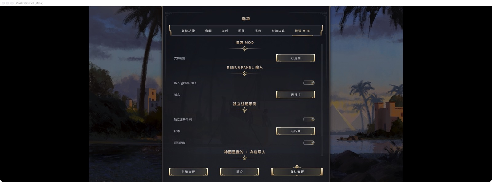
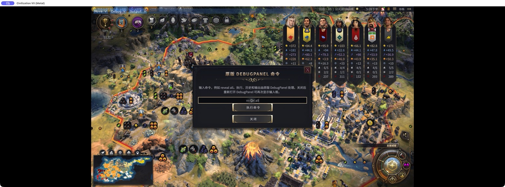
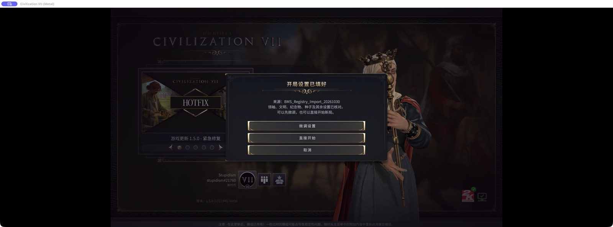

# Registration framework and in-game console — 2026-10-30

Agent-run live validation, not user acceptance. Apple Silicon, macOS 27.0.1, Steam Civilization VII 1.5.0 (1311346), bundled ARM64 Node 24.22.1. Better Mod Support 0.2.0-dev, Native Debug Input 0.4.0-dev and Play Again 0.4.0-dev. The earlier Cocoa-window report is separate evidence.

## Live results

| Scenario | Observation |
| --- | --- |
| Stable Steam entry | Direct script and `/bin/sh` launch options failed with Steam OS Error 0. The fixed `BetterModSupport/Current/civ7-mac-launcher/Civ7 Mod Launcher.app/Contents/MacOS/Civ7ModLauncher` executable successfully launched both later packages, without feature flags. The installer updates Current; Steam's option stayed unchanged across updates. |
| Native Options | Original accessibility/audio/game/graphics/system/mod categories remained, plus the separate Enhanced Mods tab. Prefixed UI filenames fixed a demonstrated Cohtml basename collision: importing the original options.js had incorrectly returned framework exports. |
| Registration and preferences | A separately installed example, unknown to framework code, registered its own title and verbose setting. Confirm enabled it and its echo response contained the chosen setting. Cancel invoked the stock confirmation and left the component disabled. Preferences survived a game restart and context changes. |
| Mac persistence | Native localStorage writes did not read back successfully on this host. Framework preferences now use an atomic, private launcher file with revision-correlated acknowledgements; other mods' native storage is not modified. |
| In-game original console | Actual keyboard events entered `reveal all` in the game's fxs-textbox after clicking it. The Run button passed in r3; native text-edit-stop handling made Return pass in final r5. The native bridge recorded `native InputText submit: reveal all`. A correlated acknowledgement was written. Read-only map counts changed from 2912 to 4536 of 4536, with turn 83 unchanged. No separate Cocoa input window was created. |
| Registered Play Again | A named copy of an Antiquity save was imported through its registered service. Native configuration comparison matched all 834 values with zero differences. The confirmation was cancelled; no new campaign was started. Fenhe was temporarily suspended to match the source environment; its additional-default incompatibility remains documented in the earlier report. |
| Shutdown | r3 and final r5 closed through stock Quit but launcher logs returned game exit code 11. An earlier r2 shell-only run stalled after Quit and needed SIGTERM. Helpers and launcher drained; no clean-exit acceptance is claimed. |

Keyboard events are automation evidence, not physical keyboard/controller acceptance. Bulk text/paste injection did not populate the Cohtml textbox; keyboard entry after clicking the field did. Paste/IME and controller hardware are not accepted by this test. Users should click the field, type an ASCII command, then press Return or Run. Commands still go through the original parser; no individual command mapping was added.

## Preservation

The user expressly authorized saving the active T30 campaign, exiting and testing. The entire Saves tree was copied and verified (relative paths, sizes, SHA-256) before each test/load/import round. The named user recovery save `BMS_Resume_T30_20261030_1642.Civ7Save` is retained. All 405 baseline files, including that save, matched their hashes afterward. Two named test copies and one generated configuration were archived outside the game.

Both Rest Guard script entry points were suspended and runtime inactivity checked. Installed test mods, the third-party example, Fenhe, Rest Guard, settings databases, UserOptions and Steam launch option were restored. The temporary stable launcher tree was archived. Game/helper processes were stopped, Steam reopened without launching the game, and the game lock released at 09:11:33 UTC. Receipts and full backups are local; saves, user databases and session tokens are excluded from Git.

## Remaining boundaries

The existing Cohtml bridge at 127.0.0.1:9444 remains required; the launcher does not enable it. Clean-machine/Workshop installation, Gatekeeper/notarization, Intel, other OS/game builds, imported campaign start, and physical controller behavior are untested. Exit code 11 remains unresolved. No Workshop update or merge occurred; PR stays draft for review.

Images are resized actual captures, without compositing. Local detailed receipts: `work/better-mod-support-registry-20261030/`.

## Offline verification

155 targeted Node tests passed with no skips. Three native executables passed settings/argument/ARM64 patch checks. ARM64 package builds and ad-hoc signature verification passed; installer shell syntax passed. The isolated source inventory found 9 mods, 146 manifest references and 197 JavaScript files with valid syntax. Source snapshots exclude local game artifacts.

Delivery ZIP SHA-256: `1fe90f91e309cd13bd9f50f66b2b7a24ad0a49e816af53ff6c05739970f67ce7`. All executable/UI/runtime files are hash-identical to live r5; only four README/validation text files were updated afterward. The package manifest was verified in full.
