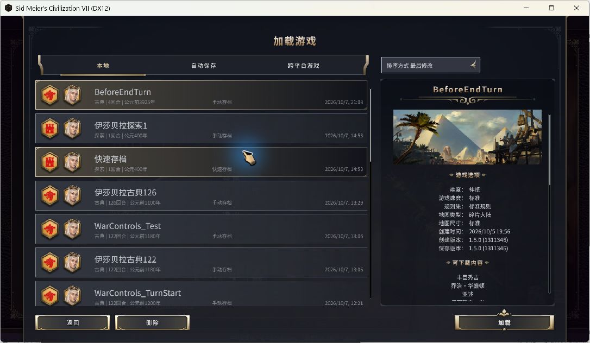

# Auto-save Before...（行动前自动存档）

当前源码版本：1.1.2（2026-10-22，跟随游戏语言设置，补齐英文提示）。用于 Steam《文明 VII》单人游戏。

[Steam 创意工坊订阅](https://steamcommunity.com/sharedfiles/filedetails/?id=3815596737) · [GitHub 源码](https://github.com/Stupidism/civ7-before-end-turn) · [历史版本下载](https://github.com/Stupidism/civ7-before-end-turn/releases)


点击“下一回合”时，先把**当前回合已经完成的操作**保存到固定的 `BeforeEndTurn` 存档，再推进回合。如果 AI 在过回合时抢了奇观、宣战，载入这个存档就能回到刚才按下“下一回合”之前。

搭配 Rest Guard 1.5.1 时：**保存成功 → 强制休息 → 点击继续 → 推进回合**。休息面板出现时，本次 `BeforeEndTurn` 已保存；保存失败则留在当前回合，重试成功后才进入回合休息。休息期间重复的过回合请求不会覆盖备份。

1.1.0 新增外交行动前保存：确认宣战、结盟、外交项目或和平交易等操作时，先覆盖 `BeforeDiplomacy`，保存成功后再执行操作。查看外交界面和查看信息不会触发保存。

## 界面语言

界面跟随游戏语言设置：简体中文显示中文，英文显示英文，其他语言使用游戏的英文回退。设置项、右上角入口、保存中提示、失败原因、重试/取消按钮及模组介绍均使用游戏原生本地化文本。固定存档名 `BeforeEndTurn` 和 `BeforeDiplomacy` 保持不变。

2026-10-22：补全中英文提示，79 项离线自动测试全部通过、0 跳过；未进行实机测试。

## 两个独立开关

打开 **选项 → 附加内容 → 自动存档 · Auto-save Before...**，或点击游戏右上角的 **存档** 直达本组设置。

| 设置 | 固定本地存档 | 默认值 |
| --- | --- | --- |
| 过回合前自动存档 | `BeforeEndTurn` | 开启 |
| 外交行动前自动存档 | `BeforeDiplomacy` | 开启 |

两个开关互不影响；点击原生“确认”保存，点击“取消”放弃本次修改。关闭其中一项不删除已有存档。设置与 Rest Guard 一样接入原生选项界面，并在共享存储中使用独立命名空间。

## 使用

1. 完全退出游戏后重新启动。
2. 在主菜单的模组管理中确认 **Auto-save Before...** 已启用。
3. 载入已有单人存档，正常操作并点击“下一回合”。存档过程中会短暂显示“正在保存过回合前的进度…”。
4. 需要反悔时，打开 **载入游戏 → 本地存档**，选择 **BeforeEndTurn**。这是普通本地存档列表中的固定条目。

鼠标按钮、下一操作快捷键、强制结束回合快捷键、手柄下一操作和官方“自动结束回合”均接入当前游戏的 `PanelAction.sendEndTurn`。

每个功能维护 **一个固定存档槽**：过回合覆盖 `BeforeEndTurn`，外交行动覆盖 `BeforeDiplomacy`，彼此不会覆盖。文件名不附加回合、时代或日期，同一台电脑上的不同单人对局共用这两个槽位；需要长久保留某个节点时，请另存一个手动档。外交回退时同样从 **载入游戏 → 本地存档** 选择 `BeforeDiplomacy`。

官方自动存档继续遵循你原来的设置。模组的固定槽独立于快速存档，因此 F5 快存和快速载入仍对应官方快速存档，而不是 `BeforeEndTurn`。



上图为本机实际“载入游戏 → 本地”界面，选中了已有的 `BeforeEndTurn` 存档。截图展示存档位置，不代表已完成当前版本的存档/读档全流程验证。

## 安装与卸载

本机安装位置：

```text
%LOCALAPPDATA%\Firaxis Games\Sid Meier's Civilization VII\Mods\civ7-before-end-turn\
```

订阅工坊版时，请先退出游戏，把已有手动版文件夹移到 Mods 目录之外，避免同一 Mod 同时加载两份。

重新安装时，把压缩包中的 `civ7-before-end-turn` 文件夹放到上述 `Mods` 目录中。确认目录内直接能看到 `before-end-turn.modinfo`，避免多嵌套一层同名文件夹。

源码或解压目录中的 `install.ps1` 可用于 Windows 手动安装：先退出游戏，再用 PowerShell 运行。脚本会先备份原模组到 `ModUserData/SaveBeforeEndTurnBackups`，复制运行文件并逐一核对哈希；游戏运行时会拒绝覆盖。

卸载时，在游戏中禁用此模组，或退出游戏后删除这个模组文件夹。已有 `BeforeEndTurn` 和 `BeforeDiplomacy` 普通存档仍可从游戏的载入界面管理。

这是 UI 模组，`AffectsSavedGames=0`，可以用于已有对局。

## 存档失败时

模组等待游戏发出成功的 `SaveComplete` 通知后才真正提交结束回合或外交行动。存档期间暂时锁住输入，避免保存后又进行了其他操作、导致备份与操作前状态不一致。

保存被拒绝、保存报错、检测到并发存档或 60 秒没有完成通知时，会留在当前回合并提示。可选择“重试存档”或“留在本回合”。失败后自动结束回合不会循环重试；手动再次点击“下一回合”可以重新尝试。

外交存档失败时，可以重试或取消外交行动；保存尚未确认成功时不会提交该行动。一次确认包含多个原生命令时，只保存一次，随后按原顺序执行。例如回应战争请求后宣战，或从地图宣战后移动单位。

游戏有时已写入文件，却没有向模组送达完成通知。1.0.2 在等待 5 秒后尝试一次重新覆盖：游戏仍忙时继续等待原请求；游戏接受新请求时清除残留计数，并等待这次重新保存的开始及成功通知。不会仅凭超时或文件存在就放行回合。

如果磁盘已满或游戏的写入过程出错，旧存档是否完整仍取决于游戏本身。模组不会把“请求已发送”当作“文件已保存”。

## 适用范围

- 仅在本地玩家活动回合的单人游戏中执行。多人、热座和 Autoplay 直接沿用游戏流程。
- 外交覆盖标准界面的宣战、议和、结盟/解盟、外交项目及回应、首次会面回应和和平交易的提出/接受/拒绝。AI 回合中的回应不执行本模组的保存逻辑。
- 当时代已经结束、游戏的 `ContextManager.canSaveGame()` 禁止普通存档时，会提示并保留最近一次有效的 `BeforeEndTurn`，然后允许继续时代转换。触发时代结束之前的那个正常回合已经按相同规则保存。
- Rest Guard 的加载顺序是 2000，本模组游戏作用域为 3000；存档包装器在外层，保存成功后才进入休息。Rest Guard 1.5.1 提供请求检查，休息和设置界面期间不重复保存；写盘期间新到期的时间休息延后到保存结束。
- 其他模组若绕过标准 `PanelAction.sendEndTurn`、直接调用原生结束回合接口，可能绕过本模组。直接替换整个行动面板的模组也需要单独验证。
- 外交功能接入当前游戏的原生外交操作与交易提交入口；游戏更新或其他模组替换这些入口后需要重新检查。
- 游戏更新后，如果过回合入口或原生存档接口变化，需要重新适配。

## 1.1.1 验证情况（2026-10-20）

79 项本模组自动测试和 69 项 Rest Guard 测试全部通过，0 跳过。联动测试读取本机实际的行动面板代码，以模拟保存事件验证鼠标、快捷键、手柄和自动过回合入口均先保存，再休息，最后只提交一次回合；同时覆盖保存失败重试、休息期间重复请求、写盘期间计时到期，以及分别关闭保存或休息的情况。

本次为离线检查，没有启动、重启、加载或推进游戏，没有改写游戏存档。新顺序尚待游戏内验收；工坊发布内容保持 1.1.0。

## 历史验证情况（2026-10-18 发布复查）

开发依据是本机正式游戏文件：**1.5.0.44 / 1311346**，Steam build **25516395**。

- JavaScript 语法、modinfo XML 和引用文件检查通过。工坊 1.1.0 下载包的 8 个运行文件已逐一核对 SHA-256。
- Apple Silicon Mac / Metal 主菜单已成功加载；当前版本的外交存档与设置在对局内仍待完整验收。
- **70 项自动化测试通过，0 项跳过**，包括当前本机 Rest Guard 控制器的集成检查。
- 新增检查覆盖两开关的四种组合、原生选项确认/取消、持久化失败、保留其他 Mod 设置、外交动作批量提交、重试/取消、交易会话保留以及宣战后移动的顺序。
- 外交集成检查读取本机实际的和平交易处理函数与地图宣战确认函数，使用模拟原生接口执行。已在运行中的游戏核实外交接口可被扩展；**新版设置与外交存档尚未完成实机验收**。
- 1.0.2 实际游戏中已验证连续覆盖存档、正常保存后提交回合，以及游戏自动存档后的状态恢复；这些是上一版的结果。
- 覆盖：保存完成前不得过回合、连续点击去重、固定覆盖槽、等待已有存档、忽略其他种类的存档完成通知、失败与超时、迟到回调、切换对局/时代/玩家后取消旧请求、输入锁定、多人绕过、与 Rest Guard 的调用顺序。
- 集成检查读取本机游戏实际的 `panel-action.js` 与 Rest Guard 代码，使用模拟原生接口执行。
- 实机故障注入验证：屏蔽首次原生完成通知，约 5.5 秒后重新覆盖成功，测试 continuation 仅执行一次，测试回合未推进。
- 首次完成通知为何偶尔缺失尚未确定；已修复该状态下计数残留、反复重试仍卡住的问题。
- 用户反馈重新载入后恢复正常；尚未独立完成“移动单位 → 保存 → 重新载入核对单位”的完整验收。

首次验收建议：在一回合内移动一个单位后过回合，检查本地列表中的 `BeforeEndTurn`；载入后应回到刚才那一回合，且单位已经移动。随后再过一回合，确认列表中仍只有一个同名条目且时间更新。完成这次检查后即可确认你当前游戏环境的实际保存行为。

外交验收应在可回退的测试存档中进行：确认外交行动后检查 `BeforeDiplomacy`，重新载入应回到行动执行前；分别关闭两个开关，再重载游戏核对设置及对应保存行为。不要用未备份的正式进度测试宣战。

## 开发与排查

无需 npm 安装依赖。源代码目录内运行：

```text
node --test tests/*.test.mjs
```

集成测试默认使用本机 Steam 游戏路径；可通过环境变量 `CIV7_GAME_DIR` 指定其他位置。没有游戏源码的机器会跳过游戏适配测试；独立的状态机测试仍可运行。

日志位于：

```text
%LOCALAPPDATA%\Firaxis Games\Sid Meier's Civilization VII\Logs\UI.log
```

搜索 `[Before End Turn]`。加载成功时有 `Ready`，存档完成并准备推进回合时有 `Saved BeforeEndTurn at turn ...`。模组发现/加载问题可查同目录的 `Modding.log`。

实现依据：游戏自带 `Base/modules/core/ui/save-load/model-save-load.js` 的覆盖保存参数和完成事件；`Base/modules/base-standard/ui/action/panel-action.js` 的过回合入口；`Base/modules/core/ui/context-manager/context-manager.js` 的可保存状态判断。发行包只包含本模组原创代码，测试从本机读取游戏文件。
