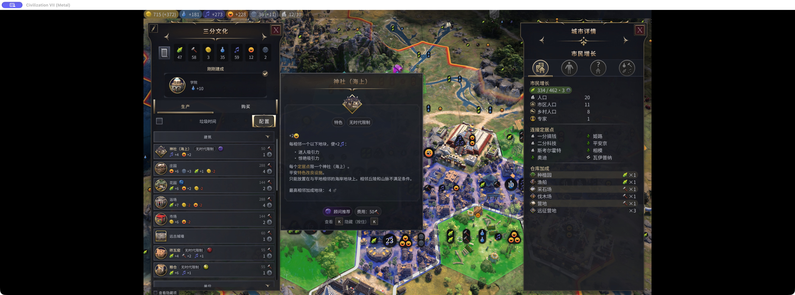
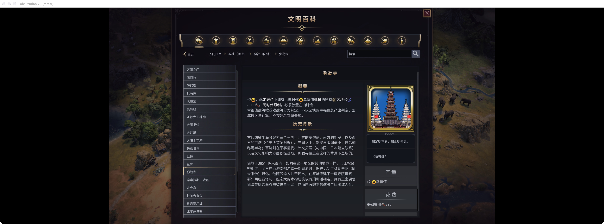
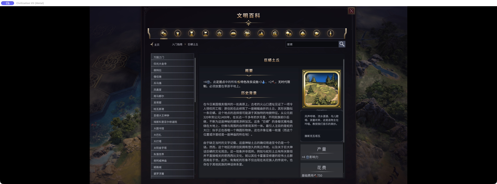
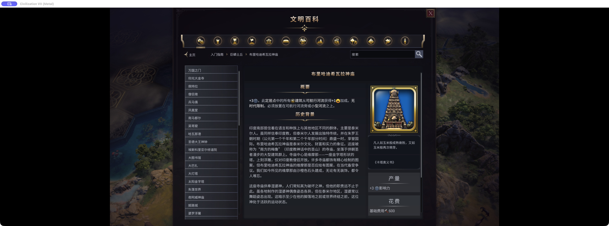

# 验证记录 · 2026-10-28

## 当前源码 0.2.1 · 2026-10-29

- 按用户要求只纠错、补遗漏：神社保留完整原文及百科链接，仅追加海上版本的海岸与邻接平地条件；撤销陆地神社补充，不重复改良设施的乡村通用规则；弥勒寺不列建筑名称，改为“古典时代幸福值建筑”，并注明按游戏分类判定。
- 收紧其他条目：巨蟒土丘只加“平地”；保留原有链接和正确措辞。神庙原文与官方英文“adjacent to a Navigable River or on a Minor River”一致，撤销其两条修改，当前共 29 条。
- 核对当前官方 XML：弥勒寺固定检查 AGE_ANTIQUITY 和 ANTIQUITY_HAPPINESS，没有找到跨时代替换此条件的规则。音乐厅等建筑基础幸福值大于 1，但没有该标签，不能概括成“任何自身产出至少 1 幸福值的建筑”。
- 10 项离线检查通过，覆盖真实官方文本、精确修改键集合、原文保护、重复加载、原生导入空白，以及神社原文逐字保留。
- 2026-10-30 已完成下述 0.2.1 实机显示复验；下方 0.2.0 记录仅保留作历史参考。

## 0.2.1 实机显示复验 · 2026-10-30

Civilization VII 1.5.0 (1311346)、macOS Metal、简体中文。读取当天最新自动存档的命名副本（测试场景第 30 回合）、原问题城市的既有第 83 回合测试副本，以及既有探索时代第 1 回合测试世界；未推进回合或下达生产订单。

- 古典、探索两个场景均为 **29/29 修改键 + 4/4 原文对照键**逐字匹配。陆地神社和布里哈迪希瓦拉神庙的描述与提示保持原文。
- 逐页截图并目视核对 15 个原生百科页面，包括海上/陆地神社、弥勒寺、巨蟒土丘、布里哈迪希瓦拉神庙、南马都尔、紫禁城、长城、亚述王宫，及相关领袖、文明页面。关注的说明、图标完整可见。时代变体与全部提示框布局未逐一覆盖。
- 海上神社的实际生产行通过焦点事件显示原生提示，海岸与相邻平地条件完整，无裁切；这是游戏内组件显示验证，不是物理鼠标悬浮测试。引擎返回的可放置格 `(19,29)` 为海岸，邻格 `(20,29)` 为平地。未实际建造或尝试非法格。
- 弥勒寺百科显示“古典时代幸福值建筑”、分类判定和按区块计算的说明。原问题城市的产出明细数据列出弥勒寺生产力 +1、文化 +2；此处不是重新建造前后的对照实验。当前城市界面 Mod 组合下，旧提示管理器未打开弥勒寺建筑提示，此路径未验收。
- 两条氏族社会传统在该场景未检索到精确百科页，其运行时文本已匹配；未覆盖跨时代弥勒寺效果组合。
- 初查发现本地仍为 0.2.0，工坊目录内的 0.2.1 是未注册缓存。旧包完整移至游戏目录外保留，安装并启用本地 0.2.1 后重测。最终 7 个安装文件与已发布包逐字节一致，未修改运行代码或再次发布。
- 5 次完整测试前备份、1 次完整收尾备份均按文件列表、大小、SHA-256 核验。原始 401 个文件、6 个目录恢复核验；新命名测试副本保留。两份 Rest Guard 清单、设置恢复，临时活动标记清除，游戏正常退出，锁已释放。

结构化回执：[live-validation-0.2.1.json](docs/live-validation-0.2.1.json)。原始证据：`work/better-chinese-021-live-20261030/`。以下 JPEG 只转换格式，未裁剪、重绘或添加标记；原始 PNG 哈希留在回执中。

| 海上神社生产提示 | 弥勒寺百科 |
| --- | --- |
|  |  |

| 巨蟒土丘百科 | 布里哈迪希瓦拉神庙原文 |
| --- | --- |
|  |  |

## 历史版本 0.2.0

仅保留玩法描述勘误。9 项离线检查通过，0 跳过。2026-10-28 在 Civilization VII 1.5.0 (1311346)、macOS Metal、简体中文中完成下述实机检查，修正版已安装。

### 0.2.0 实机结果

- 读取最新正常自动存档第 83 回合副本，原生百科在古典时代不列出这两个探索时代奇观。尝试读取探索 44 回合副本时，游戏因缺少该旧存档记录的 `unlock_all_mementos_continued` 拒绝加载；未安装或修改该依赖。
- 创建独立探索时代第 1 回合测试世界，逐一打开巨蟒土丘、布里哈迪希瓦拉神庙的原生百科；截图确认中文、图标和新增放置条件完整可见、无裁切。神庙仍显示仅从可航行河流获得建筑幸福相邻加成。
- 检查全部 33 个文本的实际 `Locale.compose` 结果，首次发现神社的两条 Tooltip 未命中：原始 XML 的前导空格被游戏本地化导入器去除。构建器现同时精确匹配 XML 原文及仅去除首尾空白后的原文；不放宽到任意内容覆盖。新增真实文本去空白回归通过。
- 安装修复后重启，用独立测试世界副本复核，33/33 文本逐字一致；再次打开两个奇观百科并截图确认。
- 未测试实际建造或产出变化，未验证生产列表鼠标悬浮排版；33 条运行时匹配不等同于 33 个页面均已目视验收。未推进回合或下达生产订单。
- 启动、读取、创建测试世界前均做完整且逐路径、大小、SHA-256 验证的 Saves 备份。结束时另存完整测试后备份，再恢复被读档和新世界轮换的原文件；最初 410 个文件和 8 个目录核验通过，测试副本保留。
- 两处 Rest Guard 清单逐字节恢复，modSettings 未变，临时活动标记清除，UserOptions 恢复。两次正常退出请求后窗口已关闭，但进程残留；对确认的本次游戏进程发送 TERM 完成退出，随后才恢复文件。当前游戏已关闭。

原始证据：`work/better-chinese-020-live-20261028/verify-all-final.json`、`serpent-verified.png`、`temple-verified.png`、`restoration.json`。结构化回执：`docs/live-validation-0.2.0.json`。

### 离线检查

- 使用本机当前官方中文资产与真实本地化数据库 schema 验证 SQL。
- 实际仅改变明确清单内 33 个原版中文键；所有其他原版键逐项保持，包括名称、台词和历史文本。
- 元数据中英文键对应；英文、繁体中文游戏文本保持不变。
- 无 DLC 时不创建原版内容键；原文匹配保护、重复执行不累加、参数保持检查通过。
- 运行清单仅含 UpdateText；运行包不含旧 community.sql、official-samples.xml。
- 对照官方地形/生物群系、河流、区块、建筑标签及效果作用范围；布里哈迪希瓦拉神庙仅修改放置句，仍保留可航行河流幸福加成条件。
- 已筛选的 29 条社区规则作用于 26 个文本键，神社、弥勒寺另外 7 个键；原始清单其他规则不进入运行包。未对全部剩余功能条目作完成承诺。

具体范围与规则定位：`reference/functional-selection.json`。逐条补丁和官方本地化文件哈希：`docs/import-audit.json`。离线验证不能证明游戏界面的排版和鼠标提示已经正确显示。

## 历史版本 0.1.0 实机证据

2026-10-28 在 Civilization VII 1.5.0 (1311346)、macOS Metal、简体中文环境，用最新第 83 回合自动存档的独立副本检查了陆地神社、海上神社、弥勒寺的原生文明百科页面：中文、图标、换行与新增条件完整显示。城市“三分文化”明细列出弥勒寺生产力 +1、文化 +2。

这 7 条神社/弥勒寺补充文字在 0.2.0 中保留，但上述证据仅来自 0.1.0，不代表 0.2.0 全包或新增功能条目已实机验收。生产列表鼠标悬浮路径当时未验收；未重新验证神社实际建造行为。

当次已完整备份 Saves，测试后 390 个原始文件按路径、大小、SHA-256 恢复核验；验证副本保留。Rest Guard、modSettings、UserOptions 恢复，活动标记移除，游戏退出。

历史原始证据：`work/better-chinese-live-20261028/`；历史安装回执：`docs/installation-live-2026-10-28.json`。二者均是 0.1.0 的记录，不覆盖当前版本状态。

## 2026-10-30 仓库收录验证

- 模块 10 项离线测试通过；无本机游戏的路径另外验证为 4 项通过、6 项官方资产检查跳过。
- 根目录检查通过，并将本模块纳入 `npm test` 和 GitHub Actions。现有六个模块回归无失败。
- 重新构建后的 4 个运行文件（清单及三个文本文件）与工坊 0.2.1 下载回执 SHA-256 完全一致。仅补充测试入口、开发配置和归档文档，未重新上传发行包。
- 历史 JSON/Markdown 中本机用户名路径改为 `~` 或仓库相对路径；原始回执仍留在本地工作目录，原有文件哈希保持不变。
- 本轮未启动或操作游戏，不新增实机验证结论。已发表文案和总目录归档见 `../../docs/publications/`。
