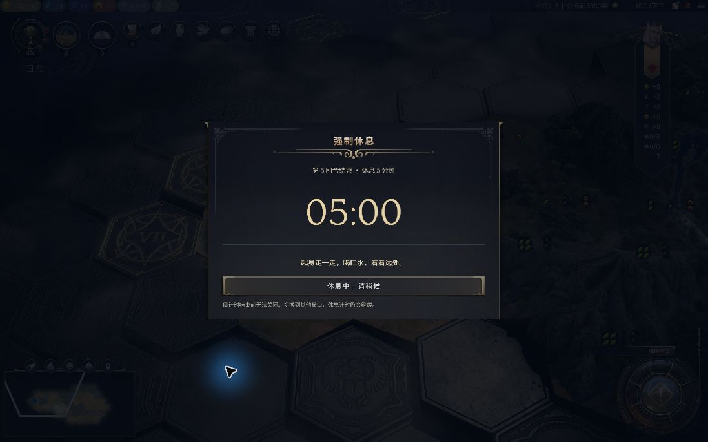

# No More Turn（不再来一回合）

为《文明 VII》单人游戏加入按回合、按时间休息及夜间禁玩。三项功能独立开关，休息时自动存档，默认保留最近10个休息存档。

**当前开发版本：1.8.5 · Windows / Steam 1.5.0 接口 · 新版界面及联动待实机验证**

[Steam 创意工坊](https://steamcommunity.com/sharedfiles/filedetails/?id=3815557333) · [下载发布版](https://github.com/Stupidism/civ7-rest-guard/releases) · [完整使用说明](README-zh-CN.txt) · [验证记录](VALIDATION.txt)

1.8.2 修复中文正文显示方框：使用游戏原生 `font-body` 随文字语言选择字体。新增离线浏览器回归检查，确认中文正文实际使用游戏中文字体；未启动游戏测试。

## 语言

界面跟随游戏内的文字语言设置，提供英文和简体中文，其他语言使用原生英文回退。休息弹窗、按钮、存档状态、工具栏和设置说明全部使用游戏翻译系统，不读取操作系统或浏览器语言。名称保留“No More Turn（不再来一回合）”。[English guide](README-en.md)。

## 默认规则

### 按回合休息

在本次游戏会话的内存中累计结束回合次数，达到当前档位的间隔后休息，不再对游戏回合号求余数。重复的过回合请求只计一次；读档、跳到更晚的存档、回退或切换时代都不会补算回合，也不会清空已有累计。完整退出游戏后重新从零累计。

| 当前回合 | 默认休息间隔 |
| --- | --- |
| 1–20 | 每 5 回合 |
| 21–40 | 每 4 回合 |
| 41–60 | 每 3 回合 |
| 61–80 | 每 2 回合 |
| 81 及以后 | 每回合 |

游戏当前回合只用于选择上表的间隔档位；每档间隔可以调整为 1–100 回合。跨档保留已有累计，按新间隔判断。关闭回合功能时暂停累计。

例如刚启动后读入第 10 回合存档，初始计数为 0，结束第 10–14 回合共 5 次时才触发休息。已经累计 2 次后读入其他存档，计数仍为 2。

### 按时间休息

- 连续游戏 **25 分钟**后强制休息 **5 分钟**，无需等到结束回合。
- 游戏内读档、返回主菜单后重新加载的等待时间计入本次连续游戏时间。
- 连续无操作 1 分钟后显示与强制休息相同样式的“主动休息”面板，以正计时显示已休息时长，“继续游戏”始终可点。
- 主动休息期间暂停连续游戏计时，鼠标移动或其他操作不会关闭面板。提前继续保留此前累计的游戏时长和回合间隔；满 5 分钟视为完成一次休息，两项间隔共同重置。
- 点击“继续游戏”才恢复计时，不会自动结束回合；离开更久不会重复弹出休息锁。也可按 Enter 或手柄确认继续。
- 完整退出游戏后，本次计时清零。关闭时间功能也会关闭空闲自动重置。

连续游戏上限可设为 1–240 分钟，休息时长可设为 0.1–120 分钟。

### 共同重置

两项默认同时开启，先到期的一项触发休息，同时到期只休息一次。完成强制休息或空闲休息后，游戏时间和下一次回合休息间隔一起重置。

例如已累计 3 回合后先完成时间休息，回合累计清零，下一次重新累计完整的间隔。刚休息完的当前回合放行，不再次计入新一轮；分档仍取游戏当前回合。

## 休息时自动保存

主动休息、按时间或回合强制休息、夜间禁玩开始时，各自动创建一份独立的本地普通存档。无需安装 Auto-save Before...。文件名示例：

```text
RestGuard_Idle_T33_20261021-091500-123_1-abcdef
```

`Idle` / `Time` / `Turn` / `Night` 区分主动、时间、回合和夜间休息，`T33` 是游戏回合，后面是本机时间戳及唯一后缀。在载入游戏的本地普通存档列表中查找 `RestGuard_` 前缀即可。

每次休息只尝试保存一次，刷新倒计时、鼠标移动和读档恢复同一次休息不会重复创建。每份使用新名称并禁止覆盖；默认保留最近 **10 个**。可在设置中的“休息存档保留数量”调整为 **1–100 个**，修改在下次休息存档成功后生效。

成功保存后查询本地普通存档，确认新文件已列出，再逐个删除超过数量的旧 RestGuard 文件。四类休息存档合计限额，跨战役累计；只识别本 Mod 的完整命名格式。原版自动存档、快速存档、其他手动存档、云存档及 BeforeEndTurn / BeforeDiplomacy 不受影响。查询或删除失败时停止清理，保留新存档，面板会提示未完成清理；下次成功保存时再尝试。

面板下方显示等待、保存中、成功或失败；悬浮可看文件名。正在进行其他存档时先等待，保存完成事件确认后才显示成功。失败、超时或游戏不允许保存时明确提示，不无限重试。主动休息仍可随时继续，两种休息均可退出；退出前请确认面板显示保存成功。

搭配 Auto-save Before... 时先完成原有回合前存档，再进入休息并创建独立的休息存档。

## 夜间禁玩

默认独立开启，按电脑本地时间在 **22:00（含）至次日07:00（不含）** 禁止游戏操作和结束回合。即使关闭按回合、按时间休息，夜间限制仍生效。到点或在时段内载入单人游戏会显示夜间休息界面，自动另存一份 `RestGuard_Night_` 存档，“继续”不可用，“退出游戏”始终可用。

在“选项 → 附加内容 → No More Turn（不再来一回合）”可单独关闭“启用夜间禁玩”，或以15分钟为步长修改开始和结束时间。支持跨午夜和同一天的区间；起止相同表示不限制。夜间锁定期间可以退出，修改设置请到主菜单的选项中进行。

到结束时间解除夜间限制，不自动提交之前排队的回合。夜间休息达到设置的休息时长后会共同重置回合和连续游戏计数；很短的时段或提前关闭不会抹掉尚未完成的普通强制休息。

## 界面

休息入口位于右上角菜单区的左侧、原版时钟紧邻左边，使用时钟相同的字体和字号，没有独立背景或外框。用游戏自带的回合、时间图标与数字显示剩余量；悬浮查看完整文字，点击直接打开“选项 → 附加内容”，选中并滚动到“No More Turn（不再来一回合）”分组。原版菜单、百科和时钟仍保留在同一栏。

关闭开关会立即隐藏其相关选项，重新开启恢复原数值，不清除配置。共用休息时长、存档数量与恢复默认始终可见可用。显示状态随草稿变化，确认才保存；取消变更恢复原配置。

设置按“回合开关→五档间隔”“时间开关→连续游戏时长”“夜间开关→起止时间”排列，后面集中放共用的休息时长、存档保留数量及恢复默认。小组之间仅使用淡色细线，不重复Mod标题装饰。

设置已并入原生“附加内容”标签，使用原版开关、下拉框、标题及底部按钮。修改后点击“确认变更”保存，“取消变更”放弃；分组内的“恢复默认”只重置本模块的草稿。每20回合一档仍固定不可调整。主菜单和游戏内均能打开此设置。

1.5.0 的主动休息面板和 1.4.0 引入的原生设置尚待实机布局、点击与截图验证。以下只保留外观未改动的 1.3.0 强制休息弹窗历史图，不用旧工具栏或独立设置页代表新版本。

强制休息期间显示全屏倒计时，阻止游戏操作和过回合。倒计时结束后点击“休息完成，继续”。按回合触发时继续原来的过回合操作；按时间触发时恢复当前回合。主动休息使用同一套全屏遮罩、原生边框及进度条，显示已休息时长，随时可点“继续游戏”。

两种休息期间均可点击“退出游戏”，或按 Esc / 手柄菜单或取消键，打开原生退出确认。确认框显示在休息面板上方，键盘、鼠标、触摸和手柄输入优先交给确认框；取消退出后仍保留原倒计时和待结束的回合，只有明确确认才退出到桌面。退出确认不会代替“继续”，也不会自动推进回合。

搭配 Auto-save Before... 1.1.1 并开启回合前存档时，顺序为“保存成功 → 强制休息 → 点击继续 → 结束回合”。保存失败先处理重试或取消，不进入回合休息；休息期间不会重复覆盖该存档。游戏禁止普通保存的特殊阶段仍沿用存档模组的提示及放行规则。



历史截图中的短时参数仅用于验证，默认仍为25分钟游戏／5分钟休息。

## 安装

### Steam 创意工坊

1. [订阅 Mod](https://steamcommunity.com/sharedfiles/filedetails/?id=3815557333)，等待 Steam 下载并重启游戏。
2. 在游戏“附加内容”中启用“No More Turn（不再来一回合）”（原名“Rest Guard（休息一下）”）。
3. 在“选项 → 附加内容 → No More Turn（不再来一回合）”调整设置；游戏内也可点击时钟左侧的休息指标直达。

如果之前手动安装过同名 Mod，请先将本地 `Mods/civ7-rest-guard` 文件夹移出 Mods 目录，避免加载两份。

### Windows 手动安装

下载并解压发布版，退出游戏后双击 `install.cmd`。也可以克隆本仓库后双击该文件。

安装位置：

```text
%LOCALAPPDATA%/Firaxis Games/Sid Meier's Civilization VII/Mods/civ7-rest-guard
```

安装器会备份已有版本，并核对复制后的文件。游戏内已有设置会保留。手动卸载时退出游戏，再移出该 Mod 文件夹即可。

## 兼容性与数据

- 仅用于单人游戏；多人及热座不启用。
- 可以用于已有单人存档，不修改原版游戏文件；休息时另存新文件，不覆盖既有存档；仅按保留数量删除较旧的休息存档。
- 设置及休息面板使用原版 `fxs-*` 控件，图标直接引用已安装游戏的资源。
- Mod 配置中长期只保存设置，不建立战役或回合历史；休息快照另存为普通游戏存档。读档时使用一次性的临时交接状态，目标界面读取后清除。
- 这是游戏内休息控制，不是操作系统级的应用锁。
- 尚未验证其他平台或所有第三方界面 Mod 的组合。

## 开发与测试

无需安装 npm 依赖。使用支持内置测试运行器的现代 Node.js，在仓库根目录执行：

```sh
npm test
```

现有 130 项测试覆盖独立夜间开关、跨午夜与夏令时边界、夜间退出及解除、存档精确筛选和串行清理、内存回合累计、读档不计数、重复请求去重、跨档累计、回合边界、时间与空闲触发、主动休息暂停及提前继续、退出确认的输入与层级、共同重置、读档交接、存储兼容性、原生设置的保存／取消／重置及分组定位。另用浏览器检查原生确认框先出现和后出现两种情况下的遮挡及点击。自动化检查不能替代游戏中的 UI 验证；实机验证范围见 [VALIDATION.txt](VALIDATION.txt)。

| 文件 | 职责 |
| --- | --- |
| `rest-guard.modinfo` | 游戏加载清单 |
| `ui/defaults.js` | 初始设置 |
| `ui/rest-model.js` | 固定回合分档与休息锁 |
| `ui/rest-session.js` | 双功能触发、空闲与共同重置 |
| `ui/rest-runtime.js` / `ui/rest-shell.js` | 游戏与主菜单间读档交接 |
| `ui/rest-save.js` | 独立休息存档命名、完成确认及失败状态 |
| `ui/rest-retention.js` | 仅清理超出保留数量的旧本地休息存档 |
| `ui/rest-store.js` | 设置保存与迁移 |
| `ui/rest-options.js` / `ui/rest-settings.js` | 原生附加内容设置、保存事务与分组直达 |
| `ui/rest-guard.js` | 游戏输入和过回合接入 |
| `ui/rest-view.js` / `ui/rest-guard.css` | 原生风格界面 |
| `tests/` | Node.js 回归测试 |

## English summary

A single-player Civilization VII mod with independent turn-based and time-based break triggers. Defaults are one break every 5/4/3/2/1 turns across fixed 20-turn stages, or after 25 minutes of continuous play, followed by a 5-minute rest. End-turn actions are counted in memory for the current session; the game turn only selects the interval stage. Loading never adds turns or resets accumulated progress. Duplicate requests count once. One idle minute opens a voluntary break panel with an elapsed timer and an always available Continue Game button. The play timer pauses during this break; resuming early preserves previous progress. Five idle minutes reset both counters. In-game loading time is included; exiting the game clears both session counters.

Each break creates a separate local normal save named RestGuard_Idle/Time/Turn plus turn number, timestamp and a unique suffix. Overwrite is disabled; the newest 10 rest snapshots are kept by default (configurable from 1 to 100). Only older local RestGuard files are pruned after a successful save; other saves remain untouched. The panel reports save status without blocking voluntary Continue or Exit.

An independent night restriction is enabled by default from 22:00 to 07:00 in local computer time. Start and end are configurable in 15-minute steps; equal times mean no restriction. Exit remains available, and settings can be changed in the main menu. The restriction lifts without submitting a queued turn.

The compact top-right indicator and settings use native game controls. The current interface is Chinese. The native Options integration and 1.5.0 voluntary break panel still need in-game validation. This repository contains the mod source and tests; it does not redistribute the game's UI assets or SDK.

### 调试与录制期间自动暂停

本地录制或其他模组调试可通过 `scripts/with-game-activity.mjs recording|debug -- <命令>` 建立临时活动标记。模组识别标记后隐藏面板、暂停回合／计时／空闲／夜间拦截以及休息自动存档，保留原设置和计数。命令结束恢复，异常中断最迟 90 秒恢复；不会自动补交之前排队的回合。不要仅因调试端口开启就永久停用。普通第三方录屏器不会自动发出此标记，使用它们时仍须手动停用模组。测试本模组自身时不要启用该标记。
